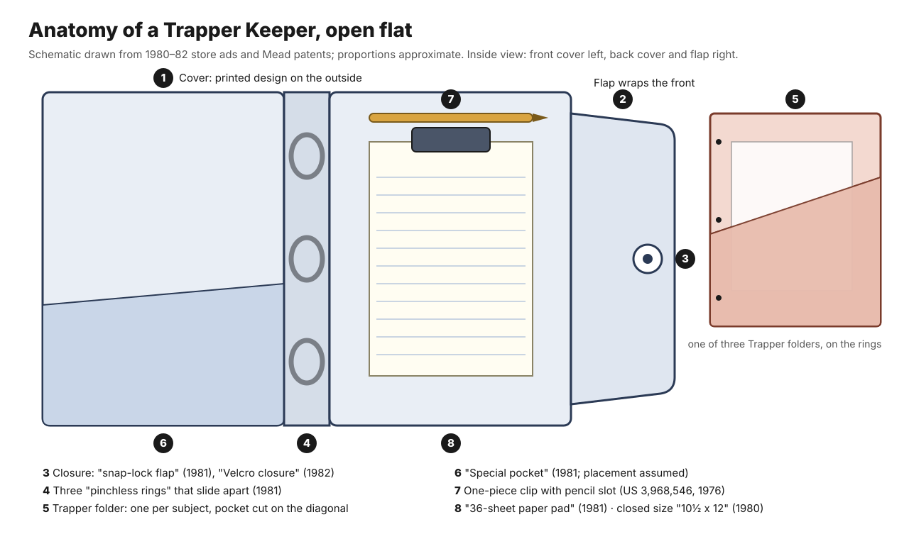

# Keep all my papers: the binder and the Trapper Keeper

*TDM 155AI · Making Stuff in the Age of AI · Learning Lab week 5 · October 2026*

## Two binders on one shelf

In August 1986 the World's Record Shop at 33 North Main in Tooele, Utah, ran a back-to-school ad in the *Tooele Transcript-Bulletin*. The list reads like a starter kit: notebook paper 99¢, a Pee Chee portfolio 35¢, a Care Bear portfolio 60¢, a "Slickers Binder" $1.79, and "Trapper Keepers .... $5.99" ([Tooele Transcript-Bulletin, 1986-08-19, p. 7](https://newspapers.lib.utah.edu/details?id=24931573)). Both binders held three-hole paper on rings, and one cost more than three times the other. A family at that shelf was choosing between two ideas of what a student's papers needed: a place to sit, or a system that would sort them, carry them, shut them in, and say something about whoever owned them.

This essay follows that choice from the loose-leaf page to a school day with a Trapper Keeper, keeping what was printed at the time (patents, trademark filings, store ads, columns) apart from what people remembered decades later. The Trapper Keeper's story has mostly been told from memory.

## A book you can take apart

A bound notebook fixes its pages in the order they were written. Loose-leaf systems break that rule: the sheet becomes the unit, and order becomes something the user maintains. The often-repeated claim that the German stationer Friedrich Soennecken invented the ring binder in 1886 turns out, on inspection, to rest on a patent for a paper punch "for binders, letter files and the like" (DRP 40065, November 14, 1886; [DPMA poster](https://www.dpma.de/docs/postergalerieneu/07_papierlocher.pdf)). The *Neue Deutsche Biographie* dates Louis Leitz's lever-arch file to 1893 ([NDB](https://www.deutsche-biographie.de/sfz50119.html)). In the United States, William P. Pitt's 1904 patent describes rings of curved hooks so that "loose leaves may be quickly attached thereto or removed" ([US 778,070](https://patents.google.com/patent/US778070A/en)).

Business adopted removable leaves first; Baker-Vawter began selling a loose-leaf ledger nationally in 1896 ([Wootton and Kemmerer, 2007](https://egrove.olemiss.edu/aah_journal/vol34/iss1/7)). A 1907 *Journal of Accountancy* article lists the advantages: no new bound ledger every year, one account to a leaf, and "dead accounts" moved out so the live ones stay together ([JofA, June 1907](https://egrove.olemiss.edu/jofa/vol4/iss2/17)).

Schools followed. In 1914 a young botanist, Ellsworth Paine Killip, kept the journal of an Adirondack canoe trip in a "Scrantom, Wetmore & Co.'s Loose Leaf Note Book for School Use," sold in styles for English, history and the sciences, and biology ([Smithsonian Transcription Center](https://transcription.si.edu/view/6648/EBNnf)). In 1937 a drugstore in Bristol, Pennsylvania, sold a 240-page composition book and a "flexible loose-leaf book" for the same ten cents ([Bristol Courier, 1937-08-27](https://archive.org/details/bristol-courier-1937-08-27/page/n2)). By 1951 a manufacturer could write of "the common 11" x 8½" 3-ring binder … with 8½" centers," the spacing that still puts holes 4¼ inches apart, and of "student-type ring binders" ([Siegel, *Bookbinding and Book Production*, June 1951](https://archive.org/details/sim_book-and-magazine-production_1951-06_53_6)). On the West Coast, Western Tablet & Stationery's Pee-Chee portfolio, in use from 1943, gave loose sheets vertical pockets ([USPTO via Justia](https://trademarks.justia.com/715/26/pee-71526166.html)); the company, renamed Westab, merged into Mead in 1966 ([Escanaba Daily Press](https://archive.org/details/escanaba-daily-press-1966-06-03/page/n2)).

By 1973 the plain binder was cheap. A Longs Drugs ad in the Daly City *Post* that August sold a vinyl or canvas binder for 79¢ and a Poly-Tuff binder for 49¢. On the facing page, inside an apple held by a cartoon boy, was "Westab — New — The Organizer," a "tri-wing vinyl binder" with a plastic ring fixture, a "clip inside back cover," pockets, "assorted designs," and a perforated pad, for $1.66 ([Daly City Post, 1973-08-29, pp. 6SM–7SM](https://archive.org/details/cdc_005315/page/n38)). Most of the Trapper Keeper was already on that page, five years early.

## Who made the Trapper Keeper

The best-known account comes from E. Bryant Crutchfield, Mead's director of new ventures, interviewed by *Mental Floss* in 2013. He described research showing more students, more classes, and smaller lockers; a sales representative's suggestion to borrow the Pee-Chee's vertical pocket, because when the folder closes "the papers are trapped inside"; and a martini lunch at which Jon Wyant, director of new product development, proposed "the Trapper" for the folder and "the Trapper Keeper" for the binder ([Mental Floss](https://www.mentalfloss.com/culture/education/history-trapper-keeper)). The 2022 obituaries, the *New York Times* among them, repeated this account ([NYT, 2022-08-25](https://www.nytimes.com/2022/08/25/us/e-bryant-crutchfield-dead.html)).

In a 2023 *This American Life* segment, Wyant, then 83, said Crutchfield asked only for "a binder that could hold these folders that had vertical pockets," and that he designed the binder, folders, flap, logo, and clip himself: "It was a full three-dimensional prototype, designed, created with colors, named, the whole works." Crutchfield's daughter allowed that "he took all the credit." Reporter Phia Bennin concluded that Crutchfield deserved credit, "just not all of it" ([TAL 815 transcript](https://www.thisamericanlife.org/815/transcript)). In June 2024 *Mental Floss* added an editor's note crediting both men.

Documents from the time cannot settle who had the idea, but they show who designed the parts. Mead patents filed between 1973 and 1975 name Wyant for a folded portfolio whose front pocket opens on a "diagonally oriented" slit ([US 3,870,223](https://patents.google.com/patent/US3870223A/en), granted 1975); Paul Seaborn and Wyant for a one-piece plastic clip that grips a pad and holds a pencil ([US 3,968,546](https://patents.google.com/patent/US3968546A/en), 1976); and Seaborn for ring fixtures, one with ring halves that slide apart instead of snapping ([US 3,833,308](https://patents.google.com/patent/US3833308A/en), 1974). None names Crutchfield, and no patent covers the Trapper Keeper as a whole. A May 1976 brainstorming memo, quoted in the 2024 note, asked for a "locker item" with components that "can be pulled for specific class or subject use."

Dates need the same care. In the remembered story, a Wichita test market with its own television spot opens in August 1978 and the national rollout follows in summer 1981. Mead's trademark applications, filed November 24, 1978, swear to first use of TRAPPER and TRAPPER KEEPER on October 30, 1978 ([USPTO via Justia](https://trademarks.justia.com/731/94/trapper-73194516.html)). The product was on sale beyond Kansas well before 1981. A Grand Central store in Ogden, Utah, advertised the "Trapper/Keeper," labelled "NEW from Mead," for $2.99 on August 1, 1979, beside Mead's Data Center and the Organizer ([Ogden Standard-Examiner](https://newspapers.lib.utah.edu/details?id=28368847)). Two weeks later a Ralphs in Upland, California, listed it too ([Upland News](https://archive.org/details/cupl_005623/page/n5)). The 1981 milestone is better described as the first national television campaign than as a first appearance.

Ads also date the redesigns. ZCMI's July 1981 insert lists a "snap-lock flap" and "pinchless rings," while a Kmart in Orem advertised a "Velcro closure" on August 23, 1982 ([Provo Daily Herald](https://newspapers.lib.utah.edu/details?id=23901158)). A "Designer Trapper Keeper Notebook" was on sale in Price, Utah, by August 1985, three years before the 1988 "Designer Series" date in company histories ([Sun Advocate](https://newspapers.lib.utah.edu/details?id=28314375)).

## A day with the binder

First period: a teacher hands out a worksheet. A plain binder needs it punched; a Trapper Keeper takes it into a Trapper folder, behind a pocket cut at an angle. The angle counts once the folder is closed and upside down: the sheet is caught at a corner instead of sitting in an open-topped sleeve. With a horizontal pocket, the sales representative told Crutchfield, "you turn it upside down, and zap!" A 1980s commercial replayed on *This American Life* stages that failure in a library and answers it with a girl who has "a Trapper folder for each subject."

Keeping subjects apart was the core promise. Each folder held one class, folders came in colors, and the binder shipped with "3 Trapper portfolios," as ads put it, with more sold separately for pennies ([ZCMI, 1981-07-19](https://newspapers.lib.utah.edu/details?id=26117399)). Some Trappers had multiplication tables and rulers printed inside; Crutchfield remembered teachers objecting that they helped students cheat, a complaint only he reports.

The locker handled carrying work between rooms. In the print ad Crutchfield described, Mrs. Willard, a ninth-grade teacher from Wellington, Kansas, explains the routine: "Most students keep the Trapper Keeper in their locker. Then, they just change Trappers from class to class" (quoted in *Mental Floss*; the ad itself has not been found). The binder stayed at base; the folder traveled. At 10½ by 12 inches, as a 1980 Cedar City ad gave it, the binder was larger than its paper, so the flap could close over the folders' edges ([Iron County Record](https://newspapers.lib.utah.edu/details?id=22334582)).

Where yesterday's notes are depends on where they went. Handouts sit in pockets, found by subject and riffling. Notes taken on the pad clipped inside the back cover ("note pad, pencil and clip," in the 1981 ad) could be torn off and filed, or punched and put on the rings. Pinchless rings that slide open sideways made rearranging safer: lift out a finished unit, add a folder, reorder for a new semester.

At the end of the day the flap closes over everything: first with a metal snap, then from 1982 with Velcro, whose ripping sound became the object's signature. A Utah mother recorded in 1984 how the promise held up. Her children said, "They hold everything, mom," and they did, "and so they are heavy and the cute little snap snapped and the handle parted" ([American Fork Citizen, 1984-04-04](https://newspapers.lib.utah.edu/details?id=22946933)).

The design promised students a container that would not spill and a cover that was theirs, parents one purchase to organize the year, and teachers papers that arrived intact. The teachers' side of the record is thin. The only period document I found of a school excluding Trapper Keepers is a 1994 *Salt Lake Tribune* column in which a parent, reading the supply list still on the fridge, promises, "I will never, ever buy a Trapper Keeper. … I just know that our school doesn't want them," and gives no reason ([Salt Lake Tribune, 1994-08-22](https://newspapers.lib.utah.edu/details?id=29398947)). The familiar explanations, Velcro noise and binders too big for desks, come from accounts written in 2013 and 2022. An ACCO designer added in 2013 that many binders banned as "Trapper Keepers" were competitors' thick zipper binders.

## Taste, belonging, and a new self

The cover was the public face: sports and nature photographs at first, then designer covers, licensed wrestlers, sports cars, and airbrushed cats. Choosing one meant choosing a face for the year. Shawn Robare, recalling 1987, wrote that "you picked the folder that best represented 'you'" ([Plastic Rocket Pop, 2012](https://plasticrocketpop.com/6240/of-trapper-keepers-and-childhood-identity)). In 1989 a Utah back-to-school column declared "Trapper Keepers rule" ([Emery County Progress](https://newspapers.lib.utah.edu/details?id=24504369)). That fall the University of Utah student paper's rules for freshmen included "Get rid of the Trapper Keepers" ([Daily Utah Chronicle](https://newspapers.lib.utah.edu/details?id=23339894)). It marked belonging in high school, then what a college student was supposed to leave behind.

The sociologist Allison Pugh calls this an "economy of dignity": children use goods, or the ability to talk about them, to earn a voice among peers ([*Longing and Belonging*, 2009](https://www.ucpress.edu/books/longing-and-belonging/paper)). Researchers have shown that "temporal landmarks," including the start of a school semester, prompt people to begin aspirational projects ([Dai, Milkman, and Riis, 2014](https://doi.org/10.1287/mnsc.2014.1901)). Applying that to the supply aisle is my leap, not theirs: a new binder is a fresh start you can hold.

Students also remade their supplies themselves. Generations drew on the Pee-Chee's athletes; *Smithsonian* catalogued the "inappropriate appendages, death metal band names, and screeds against substitute teachers" added to them ([Rich, 2012](https://www.smithsonianmag.com/arts-culture/the-pee-chee-folder-illustrated-by-the-most-interesting-man-in-the-world-43192770/)). A cheap binder offers a blank vinyl surface for markers and stickers, like the 2012 binder whose owner's friends signed it like a yearbook ([Flickr](https://www.flickr.com/photos/31855341@N00/7127206217)). The Trapper Keeper arrived already decorated, so self-expression moved from drawing to choosing. Mead's 2007 line restored some of the drawing, with a clear front sleeve for the owner's own picture.

Choosing cost money. In Tooele in 1986 the Trapper Keeper was $5.99 and the plain binder $1.79, while the federal minimum wage was $3.35 an hour: almost two hours of a minimum-wage worker's pay for one, a little over half an hour for the other ([US Department of Labor](https://www.dol.gov/agencies/whd/minimum-wage/history/chart)). The 1994 *Tribune* page holds both sides of the question. The parent-columnist writes, "Sometimes it's not worth it to be too cheap. … it's a thrill for children to have respectable supplies," next to an article headlined "Free education can have hefty price tag" on fees in Utah schools. *Respectable* is the word to notice: other children judged the supplies too, along with teachers and parents.

## What a research pack can borrow

The Trapper Keeper divided the work among its parts. A research workbook, on paper or on a screen, can make the same separations.

- **A pocket keeps things whole.** A handout, a ticket stub, a printout with someone's marginal notes stays in the form it arrived in, next to the work it belongs to. Search finds what you already know to ask for; a pocket shows you everything you put in one place, including what you forgot you had.
- **A rearrangeable page makes order a decision.** Moving sections on rings forces a choice about what sits next to what. A search result is ranked by the machine; a section order is an argument you made and can change tomorrow.
- **Separate the base from what travels.** Keep the whole workbook at home; carry one slim folder for one question.
- **Put a capture pad inside the cover.** Give new notes one place to land before they are sorted.
- **Make it closable.** A flap, or a dated snapshot of a digital folder, gives the collection an edge: you know what is in it and what is not yet.
- **Choose a cover.** The outside tells others, and you, what this collection is for.

In a digital pack: a folder of untouched source files, a hand-ordered outline, an inbox note, a dated export. An AI model can search and summarize what is inside; the pockets and the order are still yours to make.

---

## Wall label

**Keep all my papers**
*The binder and the Trapper Keeper*

Loose-leaf binders made the page, not the bound book, the unit of a record: sheets could be added, removed, and put in a new order. Mead's Trapper Keeper, on sale from autumn 1978, turned that system into a kit for the school day: a folder for each subject with an angled pocket, a pad and pencil clipped inside, sliding rings, and a flap that shut with a snap, later Velcro. A 1986 Utah ad priced it at more than three times a plain binder, and its covers made choosing one a way of saying who you were becoming. Who designed it is disputed: patents name Jon Wyant and Paul Seaborn, while marketing executive E. Bryant Crutchfield long told the story as his own. Any research workbook today faces the same design questions: where new material lands, how subjects stay apart, what travels, how order changes, and when the collection closes.

---

## Anatomy of the binder

*An original schematic, drawn from the 1980–82 store ads and the Mead patents; proportions approximate. Not a drawing of any one surviving binder.*

| # | Part | What the record says | What it does in the day | Compared with a plain binder |
|---|---|---|---|---|
| 1 | Cover | Vinyl (PVC) over board; printed photo or illustration; "Asst'd. designs and colors" ([1980](https://newspapers.lib.utah.edu/details?id=22334582)); polypropylene and sewn fabric in later versions ([Mental Floss](https://www.mentalfloss.com/culture/education/history-trapper-keeper)) | Shows the owner's choice; protects the papers | Plain vinyl in one color; blank for markers and stickers |
| 2 | Flap | Extends from the back cover and wraps over the front edge | Shuts the whole collection; nothing falls out if dropped | None; three open sides |
| 3 | Closure | "Snap-lock flap" ([1981](https://newspapers.lib.utah.edu/details?id=26117399)); "Velcro closure" ([1982](https://newspapers.lib.utah.edu/details?id=23901158)); a later return to a snap is remembered by ACCO, undated | The sound and act of opening and closing | None, or an elastic band |
| 4 | Rings | Three "pinchless rings" (1981); Seaborn's 1974 patent has ring halves that slide apart ([US 3,833,308](https://patents.google.com/patent/US3833308A/en); link to the product inferred) | Holds folders and punched pages; lets sections be reordered | Snap-open metal rings, ½ to 1½ inch |
| 5 | Trapper folders | "3 Trapper portfolios" included (1981); card with an angled pocket (compare [US 3,870,223](https://patents.google.com/patent/US3870223A/en)); some printed with tables and rulers | One subject per folder; the part that travels to class | Separate pocket folders, if any |
| 6 | Special pocket | Listed as "special pocket" in 1981 | Catch-all for loose items | None |
| 7 | Pad clip with pencil slot | "Note pad, pencil and clip" (1981); the one-piece clip of [US 3,968,546](https://patents.google.com/patent/US3968546A/en) (Seaborn and Wyant, 1976) | Capture in class without opening the rings | None |
| 8 | Note pad | "36-sheet paper pad" ([Kmart, 1981](https://newspapers.lib.utah.edu/details?id=28283784)) | Notes to tear off, file, or punch | Loose filler paper |
| 9 | Size | "10½"x12"" (1980) | Big enough for the flap to cover letter paper; sized for a locker | Varies with ring size |

---

## Visual candidates

Six candidates, with alternates. Rights notes are a starting point, not legal advice; the newspaper pages are in copyright with their publishers and suit classroom display with a credit, not reproduction for sale.

1. **The diagonal pocket, as patented.** Jon R. Wyant, "Double wing pocket portfolio and file folder," US 3,870,223, filed January 7, 1974, granted March 11, 1975, assigned to The Mead Corporation. Source: https://patents.google.com/patent/US3870223A/en . Local: `../assets/patent-US3870223-wyant-mead-1975-sheet1-flat-blank-diagonal-pocket.png`. Caption: *One die-cut sheet, folded twice: the Trapper's ancestor, with its pocket slit on the diagonal so a closed folder holds its papers.* Reuse: US patent drawings are public domain.
2. **The Trapper Keeper before the Trapper Keeper.** Longs Drugs ad, "Westab — New — The Organizer," *The Post* (Daly City, Calif.), August 29, 1973, p. 7SM. Source: https://archive.org/details/cdc_005315/page/n38 . Local crop: `../research/images/19730829-daly-city-post-longs-westab-the-organizer-1.66.png`. Caption: *Pockets, a clip inside the back cover, a pad, and a choice of designs, for $1.66, five years before the name Trapper Keeper.* Reuse: newspaper page via the Internet Archive; rights not determined; credit the paper.
3. **What the first version promised.** ZCMI insert, "The Trapper Keeper: 3 Trapper portfolios, special pocket, snap-lock flap, pinchless rings, note pad, pencil and clip," $3.99, *Ogden Standard-Examiner*, July 19, 1981, p. 100. Source: https://newspapers.lib.utah.edu/details?id=26117399 . Local: `../research/images/19810719-ogden-standard-examiner-zcmi-trapper-keeper-snap-lock.png`. Caption: *The feature list as a store printed it in 1981, a year before Velcro replaced the snap.* Reuse: in copyright (Utah Digital Newspapers lists rights with the publisher).
4. **The price of a choice.** The World's Record Shop, "Back To School Specials," *Tooele Transcript-Bulletin*, August 19, 1986, p. 7. Source: https://newspapers.lib.utah.edu/details?id=24931573 . Local: `../research/images/19860819-tooele-transcript-bulletin-trapper-keepers-5.99-slickers-binder-1.79.png`. Caption: *Trapper Keepers $5.99, a plain "Slickers" binder $1.79, a Pee Chee 35¢: one shelf, three ideas of what a student needs.* Reuse: in copyright.
5. **Inside, years later.** "School trapper keeper folder… The class paper inside is dated 1992," photographed by kvanhorn, March 17, 2015. Source: https://www.flickr.com/photos/8503402@N08/16663284940 . Local: `../assets/flickr-trapper-folder-cat-skateboard-c1992-kvanhorn-CC-BY-2.0.jpg`. Caption: *A Trapper folder kept since 1992, airbrushed cat on a skateboard, the class paper still in the pocket.* Reuse: CC BY 2.0; credit "kvanhorn / Flickr."
6. **Customized by its owner.** "Clara's school binder," photographed by dtweney, April 27, 2012. Source: https://www.flickr.com/photos/31855341@N00/7127206217 . Local: `../assets/flickr-claras-school-binder-customized-2012-dtweney-CC-BY-2.0.jpg`. Caption: *A plain binder made personal the other way: signed by friends, in marker, like a yearbook.* Reuse: CC BY 2.0; credit "dtweney / Flickr."

Alternates:

- **The plain binder as a dated object:** the blue vinyl binder holding President Ford's "Vail Strategy" campaign briefing, August 1, 1976; Gerald R. Ford Presidential Museum; public domain. https://commons.wikimedia.org/wiki/File:1976_Campaign_binder.JPG ; local `../assets/commons-ford-1976-vail-strategy-campaign-binder-PD.jpg`.
- **"Our school doesn't want them":** *Salt Lake Tribune*, August 22, 1994, p. B2. https://newspapers.lib.utah.edu/details?id=29398947 ; local `../research/images/19940822-salt-lake-tribune-never-buy-a-trapper-keeper.png`. In copyright.
- **Snap to Velcro:** Kmart, Orem, *Provo Daily Herald*, August 23, 1982. https://newspapers.lib.utah.edu/details?id=23901158 ; local `../research/images/19820823-provo-daily-herald-kmart-trapper-keeper-velcro.png`. In copyright.
- **A loose-leaf research notebook, 1914:** Ellsworth P. Killip's canoe-trip journal in a Scrantom, Wetmore & Co. school notebook, Smithsonian Institution Archives. https://transcription.si.edu/view/6648/EBNnf . Check Smithsonian terms before reproducing.
- **The pad clip:** US 3,968,546, Seaborn and Wyant, granted July 13, 1976; public domain. https://patents.google.com/patent/US3968546A/en ; local `../assets/patent-US3968546-seaborn-wyant-mead-1976-pad-clip-drawings.png`.
- **A hand-drawn cover, before the Trapper Keeper:** "1969 High School Binder," Dan Gutwein, photographed 2012 (the 1969 date is the photographer's title). https://www.flickr.com/photos/57617948@N03/26671351586 . CC BY-NC-SA 2.0.

No museum object record for a Trapper Keeper was found (Smithsonian and The Strong searched; Henry Ford and Cooper Hewitt inconclusive). Jon Wyant holds what is described as the original prototype; Crutchfield's early samples and returned feedback cards appear only as photographs credited to him in *Mental Floss*.

---

## Evidence notes

- **Contemporary documents used:** patents US 778,070 (1904), 3,833,308 (1974), 3,870,223 (1975), 3,968,546 (1976); trademark registrations 1,131,324 and 1,133,115 (filed 1978); store ads from 1937, 1973, 1979, 1980, 1981, 1982, 1985, 1986; newspaper columns from 1984, 1989, and 1994; the 1907 *Journal of Accountancy*; the 1951 trade article.
- **Retrospective accounts used, and labeled as such in the text:** Crutchfield (2013, via *Mental Floss*); Wyant and the Crutchfield family (2023, *This American Life*); ACCO staff (2013); the 2022 obituaries; Robare (2012).
- **Unverified:** the Wichita test and its August 1978 date (no Kansas source found); the Mrs. Willard ad; sales figures ("$100 million a year," "75 million sold," "half of all middle and high school students" in a 1989 press release cited by TAL and the NYT); when Mead returned from Velcro to a snap; Lisa Frank Trapper Keepers; which Seaborn ring patent the product used. Details and sources for every claim are in `../research/`.
