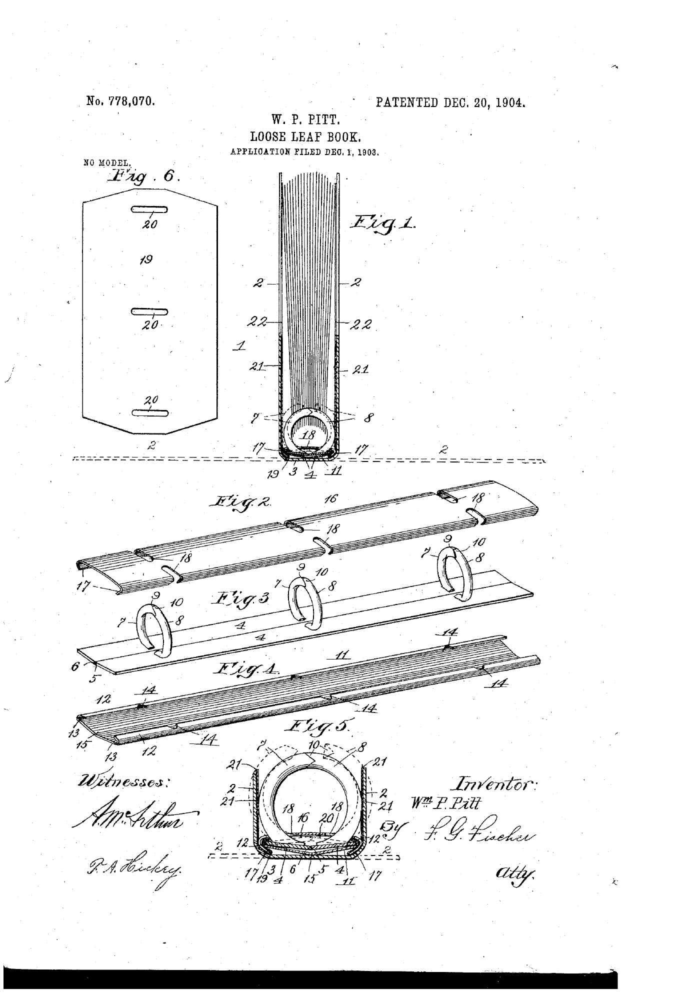
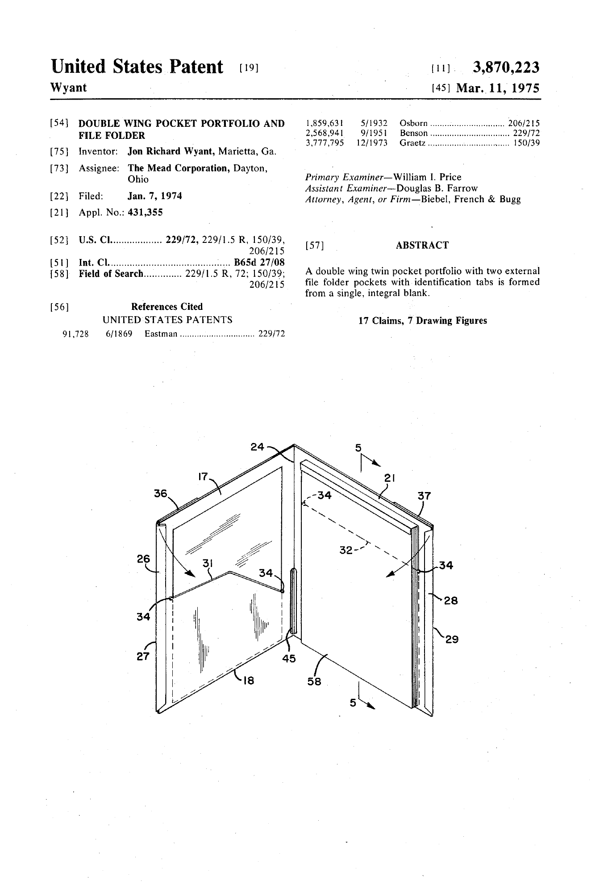
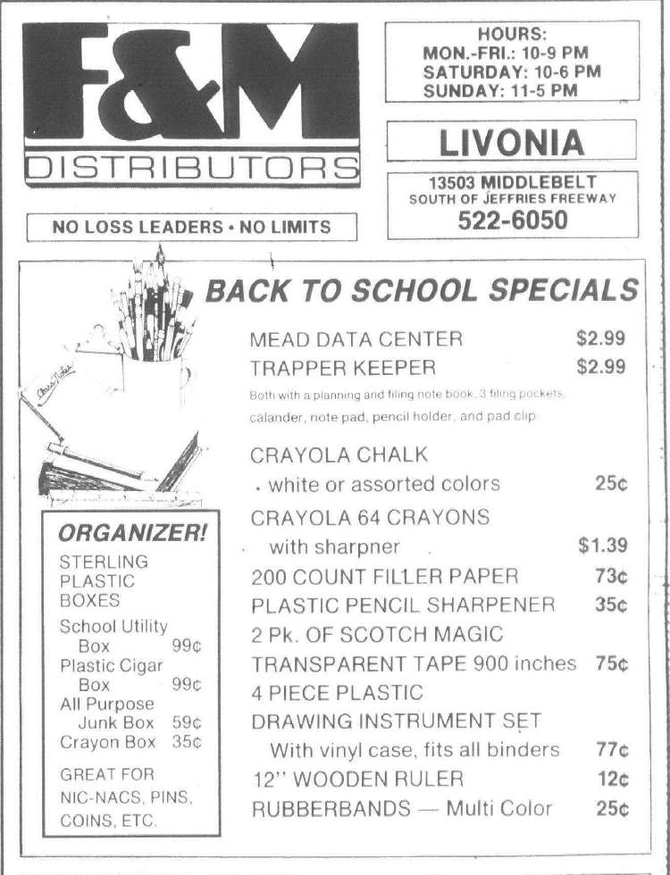
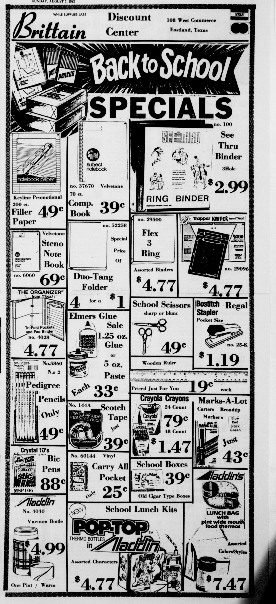
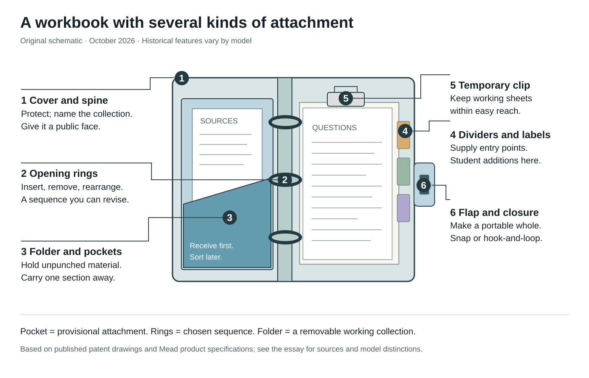

# The loose leaf binder and the Trapper Keeper

*TDM 155AI · Making Stuff in the Age of AI · Week 5 · October 2026*

## Buying an arrangement for your future

In a Mead television commercial replayed by *This American Life*, two teenagers collide in a library. The boy's papers scatter. The girl's Trapper folders keep hers together. By the end, he wants the same equipment so he can “get my act together.” The commercial makes organization social: having the right container might prevent an embarrassing accident and improve one's standing with another person. Its exact original broadcast date is not established by the replay, which identifies it as an eighties advertisement. [This American Life, episode 815 transcript](https://www.thisamericanlife.org/815/transcript).

Choosing school supplies involves an appealing possibility: the coming year might work differently. Subjects will have places. Homework will arrive intact. The person carrying this binder will be prepared. That is an interpretation of the object's appeal, rather than a claim that a binder changes grades. For a studio beginning a research week, it raises a useful question: what arrangement of materials would help the work we intend to do?

The Trapper Keeper brought together several answers. Its folders held loose papers; its rings assembled separate components; its outer flap enclosed them. A cover could announce a taste in animals, sports, color, or fantasy before the binder was opened. The object offered both a working interior and a public exterior. Those two surfaces explain why it belongs in a history of research workbooks as well as a history of consumer goods.

## A book whose sequence can change

Loose-leaf organization separates the container from the order of its contents. A bound notebook usually receives entries in an accumulating sequence. A binder lets a user insert today's evidence beside an older question, remove a completed section, or replace a page without replacing the whole book. The significant unit becomes the sheet or removable section.

William P. Pitt's United States patent 778,070, granted December 20, 1904, provides a specific early example. Its drawings show three pairs of curved hooks; the specification explains opening and closing them to attach or remove leaves. It also describes a construction that can be disassembled for repairs. Pitt calls the invention an improvement to loose-leaf books, so this document should not be mistaken for proof that he invented all removable-page organization. [Pitt patent and drawings](https://patents.google.com/patent/US778070A/en).

The binder's industrial background is visible in the Smithsonian's Alexander Binder Company records. Their finding aid describes accounting systems, advertising, catalogues, competitors' components, and surviving binder samples, including a prototype with notes dated October 4, 1918. These were tools for maintaining business information. The archive documents an industry of mechanisms, paper formats, replacement parts, and sales practices, rather than a single isolated invention. [Smithsonian finding aid, especially pages 2–3 and 14–15](https://sirismm.si.edu/EADpdfs/NMAH.AC.1100.pdf).

A school binder puts this capacity for revision into a student's hands. Teachers can introduce new sheets; students can assemble them with their own notes. The workbook remains open to incoming material, while retaining enough structure to be consulted again.

*Figure 1. A removable-page book as a mechanical assembly. William P. Pitt, US778070, first drawing sheet, December 20, 1904. This documents one improvement, not the origin of every binder. [Source](https://patents.google.com/patent/US778070A/en).*

## Who designed the Trapper Keeper

The Trapper Keeper's authorship illustrates how a successful product can acquire an oversimplified origin story. Erin McCarthy's *Mental Floss* history originally appeared in 2013, largely through Mead executive E. Bryant Crutchfield's recollections. Its June 2024 editorial note acknowledges a competing account from Jon Wyant, Mead's former director of new product development. The revised article retains the earlier narrative but marks its disputed claims. [Mental Floss, editorial note](https://www.mentalfloss.com/culture/education/history-trapper-keeper).

Contemporary patents establish narrower facts. Jon Richard Wyant is the named inventor of the double-wing pocket portfolio in US3,870,223, filed January 7, 1974, and granted March 11, 1975. Its drawing presents a folded portfolio with angled pocket edges and retained sheets. The document precedes Trapper Keeper test marketing and credits the designer of an important component. [Wyant portfolio patent](https://patents.google.com/patent/US3870223A).

The combination clip in US3,968,546, filed January 13, 1975, and granted July 13, 1976, names Paul E. Seaborn and John R. Wyant. It describes holding a paper tablet and a writing implement using a single clip structure. Even the product's apparently modest conveniences had their own design histories and collaborators. Neither component patent establishes sole authorship of the complete marketed binder. [Seaborn and Wyant clip patent](https://patents.google.com/patent/US3968546A).

Phia Bennin's 2023 radio investigation interviewed Wyant, his daughter, Crutchfield's children, and others. Wyant recalled producing the prototype, closure, folders, and logo. Bennin concluded that Crutchfield's contribution to identifying and selling the product also mattered. The defensible credit distinguishes product engineering from commercial development and acknowledges contributions from both men. Later memories can illuminate decisions; patents can document particular inventions. Neither should stand in for the other. [This American Life investigation](https://www.thisamericanlife.org/815/transcript).

*Figure 2. The folder before the famous brand. Jon Richard Wyant, US3870223, March 11, 1975. Notice how the pockets and folded panels hold sheets inside a portable unit. [Source](https://patents.google.com/patent/US3870223A).*

## Introduction and redesign were separate events

The retrospective *Mental Floss* account identifies Wichita, Kansas, in August 1978 as the test market and summer 1981 as the national rollout. It describes early snap closures, later hook-and-loop fastening, the Designer Series beginning in 1988, and a customizable cover line introduced in 2007. The closure's precise changeover year remains uncertain in that account: “third year” is not a sufficiently explicit calendar date. [Mental Floss](https://www.mentalfloss.com/culture/education/history-trapper-keeper).

A contemporary newspaper sharpens the chronology. The August 28, 1980 *Canton Observer* carries an F&M Distributors advertisement for its Livonia, Michigan, store. It lists a Trapper Keeper at $2.99, beside a Mead Data Center at the same price. Whatever “national rollout” meant inside Mead, retail promotion had extended beyond Wichita before summer 1981. The advertisement establishes availability in one Michigan market; it does not reveal how widespread distribution already was. [Canton Public Library scan, printed page 4B, PDF page 22](https://archive.cantonpl.org/observer/1980/08_Aug%201980/08-28-1980.pdf).

The object continued to change. A 1986 report reproduced by Click Americana describes plastic pinchless rings, three portfolios, a notepad, pencil clip, and hook-and-loop closure. A photographed 2016 model on Jon Crunch's blog has a snap. Mead's present Shapes model lists metal rings, two folders, an inside pocket, a metal clip, and hook-and-loop fastening; its specifications accommodate 8½-by-11-inch sheets and one-inch rings. These records describe different versions. They should not be blended into an imaginary model containing every feature at once. [1986 report as reproduced](https://clickamericana.com/topics/culture-and-lifestyle/school-education/10-totally-trendy-80s-trapper-keeper-notebooks-binders), [2016 photographs](https://joncrunch.blogspot.com/2016/08/wish-i-would-have-kept-my-trapper-keeper.html), [Mead Shapes product specifications, consulted October 5, 2026](https://www.mead.com/p/binders-filler-paper/trapper-keeper/binder-shapes-260038cq1-ecm/).

*Figure 3. Evidence before the reported national rollout. F&M Distributors, Livonia, Michigan, August 28, 1980. The price is an advertised local offer, not a national suggested retail price. [Source, PDF page 22](https://archive.cantonpl.org/observer/1980/08_Aug%201980/08-28-1980.pdf).*

## Following the papers through a school day

Imagine a student using a folder-and-binder system. This walkthrough reconstructs possibilities from the documented mechanisms; it is not a recovered account of one historical school day.

In the morning, a teacher distributes a handout. A pocket accepts it immediately, without requiring holes, a punch, or a decision about its final position. That distinction matters: a container can receive material before its owner understands how to organize it. A folder marked for the class supplies enough provisional context to prevent the sheet becoming anonymous.

Between lessons, the student can carry a subject folder separately or keep several folders together. A system with removable parts permits those choices. The folder is a small working collection; the binder is a collection of working collections. Carrying only the needed section reduces what has to be handled, although it also creates an opportunity to leave something behind.

Later, finding yesterday's notes requires another operation. A colored folder or labeled divider identifies a subject, but it cannot identify every sheet within it. Dates, headings, and a maintained sequence still matter. The manufactured object offers places; the student supplies the distinctions that make those places useful. Organization is therefore a repeated practice, not a feature fully purchased at the shop.

At home, rings allow the student to move a reference sheet beside the problem it explains, add notes, or remove pages for submission. A pocket can hold an oversized scrap, a photograph, or a sheet whose edges should remain intact. A clip offers temporary attachment. Closing the outer flap turns these different degrees of attachment into one carryable package. Mead's current product description explicitly promises retention even after a drop; that is a marketing claim about containment, not evidence of better learning. [Mead product description](https://www.mead.com/p/binders-filler-paper/trapper-keeper/binder-shapes-260038cq1-ecm/).

The design also introduces limits. Ring capacity is finite. A full pocket makes contents harder to inspect. Paper holes can tear. The collection gains weight as it grows. These consequences follow from the mechanics and invite a practical test: can you open the workbook, find the needed page, change its position, and close it while standing between rooms?

## A cover seen by other people

The cover operates differently from the filing system. It is visible to people who never read the notes. A report identified as 1986 and reproduced by Click Americana quotes children in the Burlington, Vermont, area discussing which designs were acceptable for boys and girls and the ridicule attached to choosing otherwise. The original newspaper is not identified in that reproduction, limiting its provenance. Even so, these attributed comments record a social pressure that a celebratory account of “expressing yourself” could miss. [Reproduced report](https://clickamericana.com/topics/culture-and-lifestyle/school-education/10-totally-trendy-80s-trapper-keeper-notebooks-binders).

A choice of cover can signal affiliation, but the range of choices comes partly from manufacturers and peers. The hope of being distinctive coexists with the hope of being recognizable. The first week of school makes that tension conspicuous: a supply travels into a room before its owner knows precisely who they will become there.

Students also changed the manufactured object. In a blog post dated August 26, 2016, Jon Crunch recalls boys in his 1981 third-grade class puncturing the clear outer layer of their binders, inflating it, and taping the opening shut. His “bubble binder” is a specific student-customized example, reported retrospectively without a surviving photograph of the altered object. The anecdote should remain a memory claim, not a representative survey of children's behavior. [Jon Crunch's recollection](https://joncrunch.blogspot.com/2016/08/wish-i-would-have-kept-my-trapper-keeper.html).

The alteration contributed little to filing. It made a supplied object into something the group had discovered how to manipulate. For creative students, that is a useful possibility: a working container can become an experiment in material, appearance, or shared invention, alongside its appointed job.

## Price and classroom access

The comparison with an ordinary binder can be made locally. On August 7, 1983, Brittain Discount Center in Eastland, Texas, advertised a three-hole “See Thru Binder” for $2.99 and a Trapper Keeper for $4.77. The premium was $1.78, approximately 60 percent of the cheaper binder's price. The same advertisement offered a 200-sheet pack of filler paper for 49 cents. These are one retailer's advertised offers, not national averages or evidence of household purchasing power. [Texas Tech newspaper scan, PDF page 13](https://newspapers.swco.ttu.edu/bitstreams/f9b57d96-c2c7-4528-9a70-67c62012cc01/download).

The less expensive binder retained the essential ability to assemble and rearrange punched pages. The Trapper Keeper sold a more integrated package. A family deciding among supplies was choosing which conveniences and appearances deserved the extra money. The premium also meant that a desirable school object was not equally available merely because it was widely promoted.

Restrictions are documented too. Greely Middle School's seventh-grade Team Katahdin list for 2025–2026 requires clear-view binders and excludes zippered binders and Trapper Keepers. It includes a warning about midyear breakage. That is evidence of this school's instruction and concern, not proof of a universal ban or measured failure rate. A supply can promise individual organization while conflicting with the classroom's preferred arrangement. [Greely supply list](https://gms6-8.msad51.org/apps/supplies/seventh-grade-team-katahdin-supply-list-685b93f04f041d57e7138f06).

*Figure 4. A purchase among other purchases. Brittain Discount Center, Eastland, Texas, August 7, 1983. Comparing products within one advertisement keeps place, date, and selling context consistent. [Source, PDF page 13](https://newspapers.swco.ttu.edu/bitstreams/f9b57d96-c2c7-4528-9a70-67c62012cc01/download).*

## Borrowing the design for a research workbook

For a production workbook, borrow the distinction between receiving material and arranging it. Make an intake pocket for sources that have arrived but have not yet been interpreted. A digital equivalent could be an inbox folder with a short record of where each item came from. The pocket permits useful incompleteness; it should also have an occasion for review.

Borrow removable sections. Separate a project's historical sources, visual references, practical instructions, and unresolved questions sufficiently that a collaborator can take the relevant part. Keep each item’s attribution attached when it moves. A folder of images whose origins disappear during rearrangement has retained appearance while losing research value.

Borrow the ability to compose a sequence. Put two sources beside each other because their relationship needs examination. Move a photograph next to a question. Assemble a few pages for tomorrow's rehearsal. A page's position can embody a provisional argument, and opening the binder can reveal that argument without typing a query.

Search is excellent at retrieving a named or described item. A literal pocket also accommodates an unclassified thing and lets its owner encounter neighboring things by handling them. Rearrangeable pages support deliberate proximity and a chosen order of attention. Those operations complement retrieval: they create a working situation in which a question can develop.

Finally, borrow the ordinary binder's economy. A reused container, clear labels, spare paper, and attentive revision can supply the essential system. AI might suggest headings or locate related material, but someone must decide what belongs together and what should remain unsettled. The test of the workbook is whether its arrangement helps its makers notice, compare, and begin.

---

## Wall label

Before a school year begins, a binder offers a promise: this time, everything will have a place. Mead’s Trapper Keeper combined removable subject folders, rings, a closing flap, and an expressive cover. Its engineering helped papers travel; its imagery helped students present themselves.

The history complicates the familiar inventor story. Patents credit Jon Wyant for the pocket portfolio and Wyant with Paul Seaborn for a combination clip. Later accounts also emphasize E. Bryant Crutchfield’s commercial role. A Michigan advertisement from August 1980 shows retail promotion before the often cited 1981 national rollout.

For a research workbook, borrow the operations: receive something before classifying it, keep related materials together, move pages into a new sequence, and carry the needed section. A pocket can hold an unresolved find. A rearranged page can express a developing argument. Organization begins in the container, but continues in the choices of the person who opens it.

## Annotated anatomy

*Original schematic, October 5, 2026. An explanation of operations, not a scale drawing of one historical Trapper Keeper model. The numbered key below distinguishes documented hardware from proposed student organization.*

| Number | Feature | What it enables | Limit or historical distinction |
| --- | --- | --- | --- |
| 1 | Cover and spine | Protection, identification, a surface others see | Cover imagery and materials vary across models. A student's own insert is an additional choice. |
| 2 | Rings | Adding, removing, and sequencing punched sheets or folders | Early versions used plastic mechanisms; the current Shapes model specifies one-inch metal rings. |
| 3 | Subject folder and retaining pockets | Receiving unpunched sheets and removing a whole working section | Wyant's patent documents folded panels and angled pocket geometry. The folder provides containment, not a complete index. |
| 4 | Dividers and labels | Marking an entry point into a subject or project question | Proposed student additions in this drawing; dates and page titles still do the finer work. |
| 5 | Clip and provisional papers | Keeping temporarily attached material readily available | The 1976 patent combines pad and pencil retention. Current models list a metal clip; these are different mechanisms. |
| 6 | Outer flap and closure | Enclosing the collection for transit | Snap and hook-and-loop versions are documented. Closing does not resolve internal disorder. |

*Hardware sources: [1904 binder patent](https://patents.google.com/patent/US778070A/en), [1975 portfolio patent](https://patents.google.com/patent/US3870223A), [1976 clip patent](https://patents.google.com/patent/US3968546A), and [current Mead specifications](https://www.mead.com/p/binders-filler-paper/trapper-keeper/binder-shapes-260038cq1-ecm/).*

## Six visual candidates

1. **Opening a removable-page book, December 20, 1904.** First drawing sheet of William P. Pitt's US778070. Caption: “Three opening fasteners make the book's contents replaceable; the patent also addresses repairing the mechanism.” [Dated patent and original PDF](https://patents.google.com/patent/US778070A/en). Included as Figure 1. **Reuse:** the 1904 published sheet is old enough to be in the US public domain; retain inventor, patent number, and date. No separate scan license is displayed.

2. **A portfolio engineered to retain loose sheets, March 11, 1975.** Title page and Figure 1 of Jon Richard Wyant's US3870223. Caption: “The patent names a designer of a key component several years before the test-market story.” [Dated patent and original PDF](https://patents.google.com/patent/US3870223A). Included as Figure 2. **Reuse:** no open image license is displayed; retain the patent attribution. The patent page contains no visible copyright notice. Public access alone is not a license statement.

3. **Trapper Keeper in a Michigan sale, August 28, 1980.** F&M Distributors, Livonia; *Canton Observer*, printed page 4B, PDF page 22. Caption: “A $2.99 offer documents promotion outside Wichita before the reported 1981 national rollout.” [Library's dated issue scan](https://archive.cantonpl.org/observer/1980/08_Aug%201980/08-28-1980.pdf). Included as Figure 3, cropped to the relevant advertisement. **Reuse:** no open license found; credit Canton Public Library's archive and the newspaper. No historical article text is reproduced.

4. **Ordinary binder and branded package, August 7, 1983.** Brittain Discount Center, Eastland, Texas; advertisement in *The Cisco Press* issue scan, PDF page 13. Caption: “The advertised Trapper Keeper costs $4.77; the three-hole see-through binder costs $2.99.” [Texas Tech's dated issue scan](https://newspapers.swco.ttu.edu/bitstreams/f9b57d96-c2c7-4528-9a70-67c62012cc01/download). Included as Figure 4, cropped. **Reuse:** no open license found; credit the Southwest Collection/Special Collections Library, Texas Tech University, and *The Cisco Press*.

5. **A later snap closure, photographed by August 26, 2016.** Jon Crunch's Kmart photographs show a contemporary binder open and closed, including its snap and removable folders. Caption: “A photographed later version cautions against treating hook-and-loop fastening as the brand's permanent identity.” [Dated post and photographs](https://joncrunch.blogspot.com/2016/08/wish-i-would-have-kept-my-trapper-keeper.html). **Reuse:** photographs are the blogger's work; no open license found. Link to the post or seek the photographer's permission for reproduction. Its 1981 customization memory has no accompanying photograph of the altered binder.

6. **What a classroom permits, school year 2025–2026.** Greely Middle School, Team Katahdin supply list. Caption: “The school specifies clear-view binders and excludes Trapper Keepers and zippered binders; institutional organization can overrule consumer preference.” [School's dated list](https://gms6-8.msad51.org/apps/supplies/seventh-grade-team-katahdin-supply-list-685b93f04f041d57e7138f06). **Reuse:** no open license found. Prefer a short attributed extract or a link; any screenshot should preserve school and year, and omit shopping links and other unrelated content.

## Sources and research limits

The essay distinguishes contemporary patents and advertisements from later interviews and recollections. The 1980 and 1983 newspaper pages were downloaded from their repositories, rendered, and visually inspected. PDF page numbers refer to the scanned files, not necessarily the newspaper's printed pagination. The contemporary advertisements establish offers; they do not establish purchases, national distribution, or learning outcomes. The public-domain status of the published 1904 drawing follows the duration guidance in [US Copyright Office Circular 15A, page 2](https://www.copyright.gov/circs/circ15a.pdf).

The Smithsonian finding aid identifies original catalogues and binder samples; those undigitized materials were not examined. Click Americana's reproduction of a report identified as 1986 does not identify the original newspaper, and is treated accordingly. The commercial replay does not supply an exact broadcast year. No single complete-product patent was established by this research; the two component patents support limited design credits. The 2016 student's customization recollection is not accompanied by a surviving altered object. Visual reproduction information records what was available from the sources rather than implying permission for every image.

The main essay excludes the wall label, illustration captions, anatomy, and visual list from its word count. The local print view includes the four inspected source illustrations and the original anatomy diagram; candidates 5 and 6 remain linked sources.
