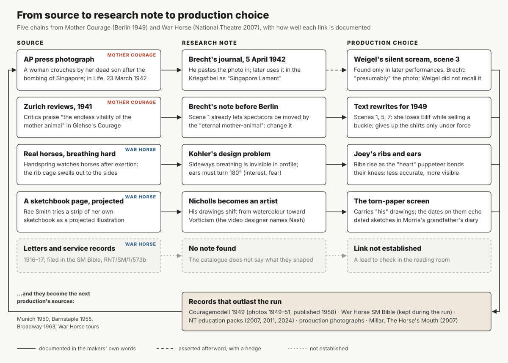
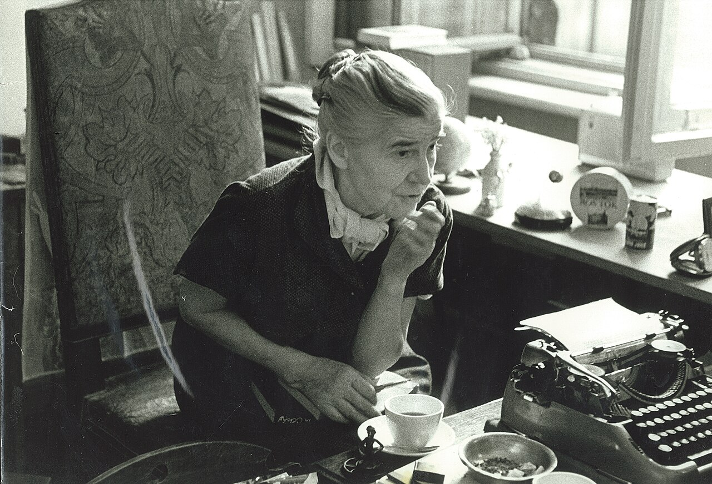
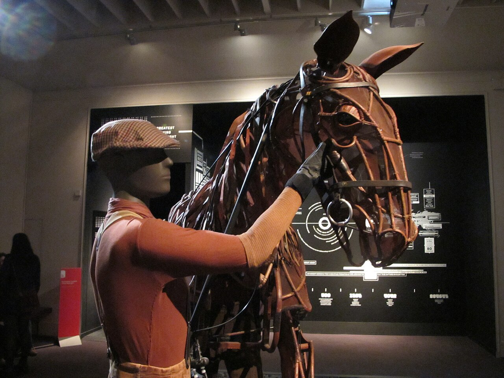

# From the file to the floor

*An illustrated essay for TDM 155AI, Making Stuff in the Age of AI, for the week 5 wall exhibition on research, notebooks, workbooks, and preparation.* Contents: the wall label, the essay (about 2,500 words with its table), the diagram, six visual candidates, a starter dossier for a student project, and three AI research tasks. The working research notes are in [`notes-mother-courage.md`](notes-mother-courage.md) and [`notes-war-horse.md`](notes-war-horse.md).

## Wall label (150 words)

> **From the file to the floor.** Before rehearsals begin, a production gathers things: photographs, letters, reviews, maps, songs, a horse's breathing. Somebody files them, and some of them change what actors and designers do. In 1942 Bertolt Brecht pasted a news photograph of a grieving woman in Singapore into his journal. Years later, he believed, it surfaced as Helene Weigel's silent scream in the Berlin *Mother Courage*, a gesture then photographed in sequence for a model book that other theatres were told to follow. In 2007 the puppet-makers of *War Horse* watched real horses breathing hard after exertion, then built Joey to breathe less accurately so that the audience could see it. This wall follows such items from source to note to stage, and asks who did the gathering, who got the credit, and when a shared file stops opening questions and starts settling them. A dossier for your own project can do either one.

## The essay

### A photograph in a journal

On 5 April 1942, in exile in California, Bertolt Brecht pasted an Associated Press photograph into his working journal. It had run in *Life* on 23 March: a woman crouching beside the body of her son after a Japanese bombing raid on Singapore. He used it again later, with a four-line epigram, in his *Kriegsfibel* (War Primer). Seven years on, in Berlin, Helene Weigel played Mother Courage at the Deutsches Theater, and in scene 3, hearing the volley that kills her son Swiss Cheese, she threw her head back and opened her mouth without making a sound. In the notes for the published model of that production, Brecht wrote that the expression "presumably" came from the press photograph of an Indian woman in Singapore, that Weigel "must have seen it years ago, although when asked she did not remember it," and that she found the posture only "in later performances." That is how observations enter an actor's stock, he added. ([Imbrigotta, *Framing Brecht*, 2013, pp. 290–93](https://asset.library.wisc.edu/1711.dl/R66FDNTW53CML8X/R/file-eaf98.pdf), quoting BFA 25:203–04; English in *Brecht on Performance*, 2014, ["Details from Scene 3"](https://brechtguide.library.wisc.edu/catalog/03151).)

That one note holds the whole subject of this wall. A source was gathered, filed, and reused; it may or may not have reached the stage by way of an actor's memory; a writer connected the two afterward, with a hedge; and the result was photographed in sequence and printed in a book meant to tell other theatres how to stage the play. Asked how gathered evidence begins to affect what people do in a rehearsal room, the answer usually has a "presumably" in it.

### Five objects that get called "the book"

Theatre people use several kinds of research object, and they blur. Separate them by who makes each one, when, and for whom.

| object | made by | when | for whom | how it changes |
| --- | --- | --- | --- | --- |
| **Dramaturgical dossier** (also casebook, research pack) | the dramaturg, or a literary office, assistant director, or staff director | before rehearsals, growing through them | director, cast, designers | added to as the room asks questions; usually stops at opening |
| **Director's notebook** | the director | before and during rehearsals | the director, sometimes assistants | private and provisional; crossed out and rewritten |
| **Designer's reference collection** (sketchbooks, image files, model) | the designer and assistants | from the first conversations through technical rehearsals | director, workshops, makers | absorbed into the design; often becomes part of it |
| **Prompt book** (prompt copy, "bible") | the deputy stage manager and stage management team | from the first rehearsal to closing night | the team that runs the show; later, revivals and tours | updated daily with blocking, cuts, and cues; frozen at closing |
| **Model book** | the company, after the fact | after a production has opened, sometimes years after | other theatres, students, posterity | selected and edited; it argues for one version |

They overlap: a prompt book can hold research, a sketchbook can end up on stage. The difference that matters most is the last row. The first four are working tools made while a production is uncertain. The model book is a record made once it is settled, and it should never be presented as the research pack that preceded the work, even though, as both productions below show, it often becomes the research pack for the next one.

### *Mother Courage*: Zurich, Berlin, and the model

The play was first staged at the Schauspielhaus Zürich on 19 April 1941, directed by Leopold Lindtberg, designed by Teo Otto, with Therese Giehse as Courage; Brecht, in exile, did not see it ([de.wikipedia](https://de.wikipedia.org/wiki/Mutter_Courage_und_ihre_Kinder)). What he did see were the reviews, which praised "the endless vitality of the mother animal" ([Hasche, *Modern Drama* 1999](https://go.gale.com/ps/i.do?id=GALE%7CA58575764&sid=googlescholar&v=2.1&it=r)). He treated that response as research. Before the Berlin production he wrote that the first scene had to change, because it already contained what had let the Zurich audience be moved mainly by the endurance of "the eternal mother-animal" ([de.wikipedia](https://de.wikipedia.org/wiki/Mutter_Courage_und_ihre_Kinder)). For 1949 he revised scenes 1, 5, and 7: Courage now loses her son Eilif to the recruiters while she is busy selling a buckle, and she gives up her shirts for bandages only under force ([Hasche](https://go.gale.com/ps/i.do?id=GALE%7CA58575764&sid=googlescholar&v=2.1&it=r); [Gelber 2023](https://link.springer.com/chapter/10.1007/978-3-031-20394-7_2)). The source here was a set of newspaper reviews; the note was Brecht's; the choice was a textual variant, and each link is in his own words.

The Berlin production opened at the Deutsches Theater on 11 January 1949, directed by Brecht and Erich Engel, with Weigel as Courage and a new score by Paul Dessau. The design is credited to both Teo Otto and Heinrich Kilger: Berlin took over Otto's Zurich design with "significant modifications" ([Hasche](https://go.gale.com/ps/i.do?id=GALE%7CA58575764&sid=googlescholar&v=2.1&it=r); [Stadtmuseum Berlin, stage model BBM 90/14](https://sammlung-online.stadtmuseum.de/Details/Index/171315)). In the model book's note on stage design, as Willett translated it, Brecht says the earlier production fixed "the excellent locations of the wagon," and through them "the groupings and the succession of events" ([*Brecht on Theatre*, pp. 215–20](https://brechtguide.library.wisc.edu/catalog/00101); wording checked only against a quotation, not the book). A previous production's design, in other words, was itself a research source. The wagon then circled "endlessly on the revolving stage" ([Stadtmuseum](https://sammlung-online.stadtmuseum.de/Details/Index/171315)).

The model book was assembled in stages, by more people than its title suggests. In 1949 hectographed notes and photographs were sent to other theatres; the notes were drafted by the assistant director Heinz Kuckhahn and corrected by Brecht ([de.wikipedia](https://de.wikipedia.org/wiki/Mutter_Courage_und_ihre_Kinder); not confirmed elsewhere). The photographs came from Ruth Berlau, Hainer Hill, and Ruth Wilhelmi, across the 1949 Berlin production, Brecht's 1950 Munich production with Giehse, and the Berliner Ensemble's 1951 revival; Hill met Brecht only in 1950, so the most reproduced images, including the silent scream, likely date from 1951, not the premiere ([en.wikipedia, Ruth Wilhelmi](https://en.wikipedia.org/wiki/Ruth_Wilhelmi); [de.wikipedia, Hainer Hill](https://de.wikipedia.org/wiki/Hainer_Hill); [Imbrigotta](https://asset.library.wisc.edu/1711.dl/R66FDNTW53CML8X/R/file-eaf98.pdf), pp. 324, 336). Brecht directed Munich from the 1949 documentation, using his own record as a source ([Gelber 2023](https://link.springer.com/chapter/10.1007/978-3-031-20394-7_9)). The book itself, *Couragemodell 1949*, appeared from Henschel only in 1958, two years after Brecht's death, in three volumes: the text, about 100 pages of scene-by-scene photographs with captions, and 103 notes; the final selection was made in 1956 with Berlau and Peter Palitzsch ([Imbrigotta](https://asset.library.wisc.edu/1711.dl/R66FDNTW53CML8X/R/file-eaf98.pdf), pp. 101–05). A record of 1949, published in 1958, built from photographs taken in 1949–51: no single date describes it.

Payment, Brecht's notes insist, must be "fully played out" ([BFA 25:185](https://asset.library.wisc.edu/1711.dl/R66FDNTW53CML8X/R/file-eaf98.pdf)). The model records the gesture Weigel devised for it, snapping her leather moneybag shut audibly after every sale ([*Brecht on Performance*, Scene 12](https://brechtguide.library.wisc.edu/catalog/03153)), and, as Gideon Lester's essay for the American Repertory Theater notes, the moment in scene 12 when she counts out the money for her daughter's burial and puts one coin back ([A.R.T., "A Model of Courage," 2001](https://americanrepertorytheater.org/media/a-model-of-courage/)). Here the direction of travel reverses: a choice an actor invented in rehearsal becomes, once photographed and captioned, a source for everyone who stages the play afterward.

### *War Horse*: a production whose research is catalogued

For the second case this wall uses the National Theatre's *War Horse* (Olivier, 2007; directed by Marianne Elliott and Tom Morris, adapted by Nick Stafford from Michael Morpurgo's novel, designed by Rae Smith, with horses by Handspring Puppet Company). It was chosen because the [NT Archive's production record](https://catalogue.nationaltheatre.org.uk/CalmView/Record.aspx?src=CalmView.Performance&id=PERF6860) links about sixty catalogued items, several of them working research. Theatre Workshop's *Oh What a Lovely War* (1963) tells a sharper story about uncredited research, but its archive at the British Library was still being catalogued after its 2021 acquisition ([Stratford East](https://stratfordeast.com/news/a-new-home-for-the-stratford-east-archive-at-the-british-library)), so its chains would rest on memoirs.

The limits matter. The NT Archive is free and open to anyone, by appointment, Monday to Thursday, at the NT Studio on The Cut in London ([NT Archive](https://www.nationaltheatre.org.uk/about-us/archive/)). Only the catalogue descriptions are online; none of the files below is digitised, and reproduction needs permission from the NT and from the artists. What follows is built from catalogue descriptions and from accounts the makers published, not from reading the files.

There is no single dossier. The research is spread across a stage-management "SM Bible" in two halves ([RNT/SM/1/573a](https://catalogue.nationaltheatre.org.uk/CalmView/Record.aspx?src=CalmView.Catalog&id=RNT%2fSM%2f1%2f573a), [573b](https://catalogue.nationaltheatre.org.uk/CalmView/Record.aspx?src=CalmView.Catalog&id=RNT%2fSM%2f1%2f573b)), which holds puppet rules, storyboards, song books in original and final versions, rehearsal notes, and sections headed "Research – extracts from letters dated 1916-17" and "Research – WWI Service Records"; the production office's show file of "research images" and rough sketches ([RNT/PO/3/1/148a](https://catalogue.nationaltheatre.org.uk/CalmView/Record.aspx?src=CalmView.Catalog&id=RNT%2fPO%2f3%2f1%2f148a)); and Rae Smith's drawing files and "Sketch Book Notes," catalogued with the sketchbook prop used on stage ([RNT/SM/1/573e](https://catalogue.nationaltheatre.org.uk/CalmView/Record.aspx?src=CalmView.Catalog&id=RNT%2fSM%2f1%2f573e)). The staff director, Polly Findlay, recalled the rehearsal-room research: a Cornish farmer's diary, "the exact pattern of First World War bugle calls," the Imperial War Museum, local county councils, and "first-hand information from various cast members' grandparents" ([2011 education pack, pp. 15–16](https://images.nationaltheatre.org.uk/uploads/2023/10/2011_War-Horse-Education-Pack.pdf)).

**Breathing.** Adrian Kohler of Handspring described watching "real horses breathing hard after physical exertion." A horse's ribs swell outward, invisible to an audience seeing the puppet in profile. So the front-leg axle was set in a slot, and the "heart" puppeteer makes the rib cage rise and fall by bending their knees: "The up-and-down replaces the more accurate side-to-side, but it is more effective because you can see it." The ears needed 180 degrees of travel, because "pointing forward they show interest, pointing backwards they indicate fear" ([Kohler, *Ingenia*, 2009](https://ingenia.org.uk/articles/engineering-movement/)). The research led to a deliberate departure from accuracy, chosen for the audience.

**Rules on the wall.** Findlay describes the Joey and Topthorn teams drawing up "lists of characteristics and tendencies" displayed in the rehearsal room, including "Horses don't like it if you look them in the eye" ([2011 pack, pp. 17–18](https://images.nationaltheatre.org.uk/uploads/2023/10/2011_War-Horse-Education-Pack.pdf)). The same "Puppet Rules" are filed in the SM Bible ([573a](https://catalogue.nationaltheatre.org.uk/CalmView/Record.aspx?src=CalmView.Catalog&id=RNT%2fSM%2f1%2f573a)) and reprinted in the education pack: a list made to guide one group of actors becomes a document handed to every later one.

**The sketchbook.** Rae Smith says the torn-paper projection screen came "almost by accident" when she tried projecting part of her sketchbook, "and that… is how Captain Nicholls developed, as an amateur artist whose war landscapes could be used" ([2011 pack, p. 19](https://images.nationaltheatre.org.uk/uploads/2023/10/2011_War-Horse-Education-Pack.pdf)). The video designer, Mark Grimmer, describes the screen as "drawings from the sketchbook of one of the characters," mixed with "some archival material," shifting toward the war artists' Vorticism; he names Paul Nash ([*Live Design*, 2011](https://www.livedesignonline.com/theatre/war-horse-s-animal-magnetism-part-3); [*LSI*, January 2008](https://www.theatrecrafts.com/archive/documents/lsi_jan2008_warhorse.pdf)). Nicholls already sketches Joey in Morpurgo's novel; the design enlarged him. Asked in 2024 why the dates on the projected sketches are accurate, a member of the creative team, most likely Morris, said "the sketches in my grandfather's notebook are dated like that" ([2024 pack, p. 11](https://images.nationaltheatre.org.uk/uploads/2023/10/2024_War-Horse_Education-Pack.pdf)), a recollection seventeen years after the fact.

**Where the trail stops.** The 1916–17 letters and the service records in the SM Bible are the most dossier-like items in the catalogue, and the description does not say what they shaped. The nearest neighbour in the same file is "Ideas for Joey's Night Scene 27." That is a lead for someone with a reading-room appointment, not a documented chain, and this wall does not claim one.

Dates need the same care. The 2011 education pack was made for the tour, four years after the opening; it reprints Findlay's 2007 account beside interviews with later casts, one of which may describe the 2008 revival rather than the first rehearsals. Mervyn Millar's *The Horse's Mouth* (2007) is an insider's account by the production's associate, written as a book for readers, not as a rehearsal file ([British Theatre Guide](https://www.britishtheatreguide.info/reviews/the-horse-s-mou-13432)).

### Who did the gathering

Both productions are remembered by their famous names, and both depended on people whose research and organizing labour is harder to see. Ruth Berlau photographed Brecht's productions from 1947, headed the Berliner Ensemble's photo archive, and made the model books possible; she described her own work as "complex service for Brecht," argued in print for proper fees for theatre photographers, and in 1954 disputed with Brecht over who would pay for the photographs in the *Antigonemodell* ([Barck on Grischa Meyer's Berlau monograph](https://www.freitag.de/autoren/simone-barck/der-soziale-blick); [Imbrigotta](https://asset.library.wisc.edu/1711.dl/R66FDNTW53CML8X/R/file-eaf98.pdf), p. 83). After Brecht's death she was shut out of the Ensemble. The assistants did the pasting. "For us, of course, working on the Modelbooks was a bit of a crappy job," Claus Küchenmeister recalled. "We sat there in a little cubbyhole, pasting things down" ([quoted in Gelber 2023](https://link.springer.com/chapter/10.1007/978-3-031-20394-7_9)). The albums Bill Gelber consulted hold dated daily reports by several assistants, photographs pasted in.

At the National Theatre the [production record](https://catalogue.nationaltheatre.org.uk/CalmView/Record.aspx?src=CalmView.Performance&id=PERF6860) names them: Findlay, who did and wrote up the research; Jane Suffling, stage manager; Janice Heyes, the deputy stage manager who kept the prompt copy; the assistant stage manager Ian Connop, whose folder holds the storyboards and the instructions for tying a rope halter; Alan Edwards of the prop department, who made the first cardboard-and-newspaper horses; Toby Olié, the first Joey hind puppeteer, who later trained the new teams. An archive that catalogues an assistant stage manager's folder under his name is already making that labour visible.

### Opening and hardening

Brecht argued that a model should provoke thought, not replace it. "The model must not be pressed too far" ([BFA 25:172](https://asset.library.wisc.edu/1711.dl/R66FDNTW53CML8X/R/file-eaf98.pdf)); the aim was "neither to copy the pattern exactly nor to break away from it at once" ([A.R.T.](https://americanrepertorytheater.org/media/a-model-of-courage/)). He also defended copying as an art, to be developed so that "no stereotyping and stiffening" sets in ([BFA 25:388](https://asset.library.wisc.edu/1711.dl/R66FDNTW53CML8X/R/file-eaf98.pdf); see also [*Brecht on Theatre*, p. 224](https://brechtguide.library.wisc.edu/catalog/00108)).

In practice the model hardened. Use of the model was at first a condition of the performance rights ([de.wikipedia](https://de.wikipedia.org/wiki/Mutter_Courage_und_ihre_Kinder)). Some at the Ensemble called the model books a "dictatorship in the theatre" ([Imbrigotta](https://asset.library.wisc.edu/1711.dl/R66FDNTW53CML8X/R/file-eaf98.pdf), p. 104). Eric Bentley described a 1959 Broadway version abandoned under legal threat before the 1963 production went ahead ([Bentley interview](https://itech.dickinson.edu/glossen/heft2/bentley.html)). Lester calls Weigel's Courage "a cultural icon to be imitated or subverted by all subsequent productions," and ends his essay: "the spirit of Helene Weigel will be stalking our rehearsal hall" ([A.R.T.](https://americanrepertorytheater.org/media/a-model-of-courage/)). David Barnett traces how the Ensemble's documentation became a yardstick of its identity and then declined from the mid-1960s ([*Theatre Research International*, 2016](https://www.cambridge.org/core/journals/theatre-research-international/article/abs/rise-and-fall-of-modelbooks-notate-and-the-brechtian-method-documentation-and-the-berliner-ensembles-changing-roles-as-a-theatre-company/DC369E9D2F6FFFB75072B22CF329BB84)).

*War Horse* shows the same pressure without an estate behind it. The puppet rules became training: later cast members describe ground rules "taught to all actors in the beginning," with puppetry associates on hand to say when they were acting "out of character" for a real horse ([2011 pack](https://images.nationaltheatre.org.uk/uploads/2023/10/2011_War-Horse-Education-Pack.pdf)). The show transferred to the West End, Broadway, Berlin, and Beijing ([en.wikipedia](https://en.wikipedia.org/wiki/War_Horse_(play))). Yet for New York the shadow puppetry was replaced with animation ([*Live Design*](https://www.livedesignonline.com/theatre/war-horse-s-animal-magnetism-part-3)), and for the 2024 revival Morris said "we're not simply mechanically putting it back together": the cast read *All Quiet on the Western Front* and visited the Household Cavalry. The same pack also says, "This is a revival… we've got a blueprint" ([2024 pack, pp. 10–11](https://images.nationaltheatre.org.uk/uploads/2023/10/2024_War-Horse_Education-Pack.pdf)).

A dossier stays open while it keeps its questions and its provenance: where each item came from, who brought it, what it was thought to mean, and what is still unknown. It hardens when the record of one answer is filed as if it were the source. Brecht's "presumably" is worth keeping for that reason. It is the part of the note that tells the next reader the connection is a guess.

## Diagram: source → note → choice



Five chains from the two productions. Solid arrows are links documented in the makers' own words; the dashed arrow is a link asserted afterward with a hedge; the grey row is a link this research could not establish. The records that outlast the run (the model book, the SM Bible, the education packs) loop back to become sources for later productions. A PNG copy is at [`assets/source-to-choice.png`](assets/source-to-choice.png).

## Six visual candidates

1. **Ruth Berlau at her desk, Berlin, 1969.** Photograph by Hilda Hoffmann. For the section on less visible labour. **Reuse:** CC BY-SA 4.0, credit "Hilda Hoffmann / CC BY-SA 4.0." Downloaded to [`assets/ruth-berlau-berlin-1969.jpg`](assets/ruth-berlau-berlin-1969.jpg). [Commons page](https://commons.wikimedia.org/wiki/File:Ruth_Berlau_Berlin_1969.jpg).

   

2. **The silent scream, beside its source.** The *Couragemodell* four-photograph sequence of Weigel in scene 3 (119a–120b), set next to the AP photograph from *Life*, 23 March 1942. Caption: "Brecht thought the gesture came 'presumably' from this photograph; Weigel did not remember it." **Reuse:** rights-reserved: the model photographs through the Akademie der Künste's Bertolt-Brecht-Archiv and the Brecht heirs, the press photograph through AP. Reproduced together in [Imbrigotta, Fig. 12, p. 336](https://asset.library.wisc.edu/1711.dl/R66FDNTW53CML8X/R/file-eaf98.pdf); license before printing, or show only as a small cited reproduction.

3. **Stage model for the 1949 Deutsches Theater production** (Heinrich Kilger after Teo Otto), Stadtmuseum Berlin, inv. BBM 90/14. Caption: "A previous production's design, reused: the wagon's positions fixed the groupings." **Reuse:** "Freier Zugang – Rechte vorbehalten" (free to view, rights reserved); ask the museum. [Record](https://sammlung-online.stadtmuseum.de/Details/Index/171315). An open alternative is Adam Jones's photograph of a *Courage* stage model at the Bert-Brecht-Haus, Augsburg (CC BY-SA 3.0; the model's maker is unidentified): [Commons](https://commons.wikimedia.org/wiki/File:Model_of_Stage_Design_for_Mother_Courage_-_Bert-Brecht-Haus_-_Augsburg_-_Germany.jpg).

4. **Courage and Kattrin pulling the wagon, scene 9, Paris 1957.** Roger Pic's photograph of the Berliner Ensemble at the Théâtre Sarah-Bernhardt, from the set Roland Barthes analysed in ["Seven Photo Models of *Mother Courage*" (*TDR*, 1967)](https://www.cambridge.org/core/journals/tdr-1967/article/seven-photo-models-of-mother-courage/41111CAA6F9A60A482188A29FC39FB33). Caption: "Production photographs became a reading tool for critics as well as a model for theatres." **Reuse: conflict.** Commons tags it public domain; the BnF's Gallica record says restricted use. Do not treat it as free until the BnF terms are checked. [Commons page](https://commons.wikimedia.org/wiki/File:Recueil._Mutter_Courage_und_ihre_Kinder,_texte_de_Bertolt_Brecht_-_btv1b10595714d_(001_of_162).jpg).

5. **The "Puppet rules" and Rae Smith's drawings as printed in the 2011 NT education pack.** Caption: "A list on a rehearsal-room wall, filed in the stage manager's bible, then handed to every later cast." **Reuse:** © Royal National Theatre; link the [PDF](https://images.nationaltheatre.org.uk/uploads/2023/10/2011_War-Horse-Education-Pack.pdf) and ask the NT before printing. The originals ([RNT/SM/1/573a](https://catalogue.nationaltheatre.org.uk/CalmView/Record.aspx?src=CalmView.Catalog&id=RNT%2fSM%2f1%2f573a), [573e](https://catalogue.nationaltheatre.org.uk/CalmView/Record.aspx?src=CalmView.Catalog&id=RNT%2fSM%2f1%2f573e)) can be seen only in the reading room. Alternative: Simon Annand's 2007 rehearsal photograph with the Goose puppet, view-only on [Google Arts & Culture](https://artsandculture.google.com/asset/war-horse-production-photograph-rehearsal-with-the-goose-puppet-goose-puppet-by-basil-jones-adrian-kohler-handspring-puppet-company-and-photograph-by-simon-annand/OwG64T-pZEQnYg) (© Simon Annand).

6. **Joey, the puppet, at the V&A.** Photograph by Maggie Jones, 2014, of the Joey given to the V&A by Handspring (S.3831:1 to 8-2013). Caption: "Built from watching real horses, and deliberately less accurate: the ribs rise and fall so the audience can see them breathe." **Reuse:** public domain (dedicated by the photographer); downloaded to [`assets/war-horse-joey-puppet-va.jpg`](assets/war-horse-joey-puppet-va.jpg). [Commons page](https://commons.wikimedia.org/wiki/File:The_puppet_horse_from_War_Horse.jpg); [V&A record](https://collections.vam.ac.uk/item/O1273373/) (V&A images allowed for non-commercial teaching use).

   

## A starter dossier for a student project

For a TDM 155AI project of any form (a short film, a performance, an installation, a set of images), set up a folder like this before making anything. It borrows the prompt book's habit of dating everything and the model book's habit of captioning, and keeps the record separate from the research.

```
my-project-dossier/
  README.md            the question the project asks, in two sentences; who is in the group; dates
  sources/             one file per source: what it is, where found (link or call number),
                       who found it, the date, and the rights status
  images/              each image with a caption file: source, date, credit, reuse terms
  questions.md         open questions, numbered; never deleted, only marked "answered by…" or "dropped because…"
  disagreements.md     where the group, or the sources, disagree; each position in its owner's words
  chains.md            source → note → choice, one line each, marked documented / guessed / not established
  rehearsal-log/       dated entries from making sessions: what was tried, what changed, why
  record/              made after: photographs, the final version, a reflection — kept apart from the research
```

Three rules carry most of the value. Every item has a finder and a date, so labour stays visible. `chains.md` uses the same three marks as the diagram above, so a guess is never filed as a fact. And nothing in `record/` gets copied back into `sources/` without a note saying it was made afterward.

## Three AI research tasks

**1. Trace a claim to its earliest source.** Give the AI a claim from your dossier (for example, "Weigel's silent scream came from a photograph") and ask for the chain of people who have made it, earliest first, with each one's exact wording and any hedges. *Checking:* open every link and find the quoted words yourself; record the hedge verbatim ("presumably," "most likely") in `chains.md`; if the AI drops a hedge or cannot produce a page, mark the link "not established." *Preserving disagreement:* if two sources date or attribute it differently, enter both in `disagreements.md` rather than choosing.

**2. Read an archive catalogue record as an inventory.** Paste in a catalogue description (an NT Archive record, a library finding aid) and ask for a table: each item, its maker, when it was made, for whom, and whether it was made during the work or after. *Checking:* compare every row against the record page; anything the AI says about an item's contents beyond the catalogue description is a guess to verify in person, and goes in `questions.md`. *Preserving disagreement:* where the catalogue and a published account give different dates (as with the War Horse education packs), keep both.

**3. Argue with your own reading.** Once the group has an interpretation, ask the AI for the two strongest readings that disagree with it, each tied to a real critic, review, or source. *Checking:* confirm each source exists and says what the AI claims; discard any that do not. *Preserving disagreement:* add the surviving readings to `disagreements.md` under their owners' names, and add a line to `questions.md` saying what evidence would settle it. The point is to keep the dossier open the way Brecht's "presumably" does, so the next reader can see where the answer was a choice.

## Gaps and cautions

- The English quotations from Brecht in Lester's A.R.T. essay are not traced to an edition; the German of "must not be pressed too far" is confirmed at BFA 25:172. The Willett wording on the wagon's locations was checked only against a quotation, not the printed book.
- Heinz Kuckhahn's role in the 1949 notes, and the claim that use of the model was a rights condition, rest on German Wikipedia.
- The contents of the NT files are known only from catalogue descriptions; nothing was read in the reading room.
- The speaker of the 2024 remark about the dated sketches is probably Tom Morris but is not certain from the pack's layout.
- No free image of the 1941 Zurich production or of a Teo Otto design sketch was found; the Deutsche Fotothek was not searchable by the research tools.
