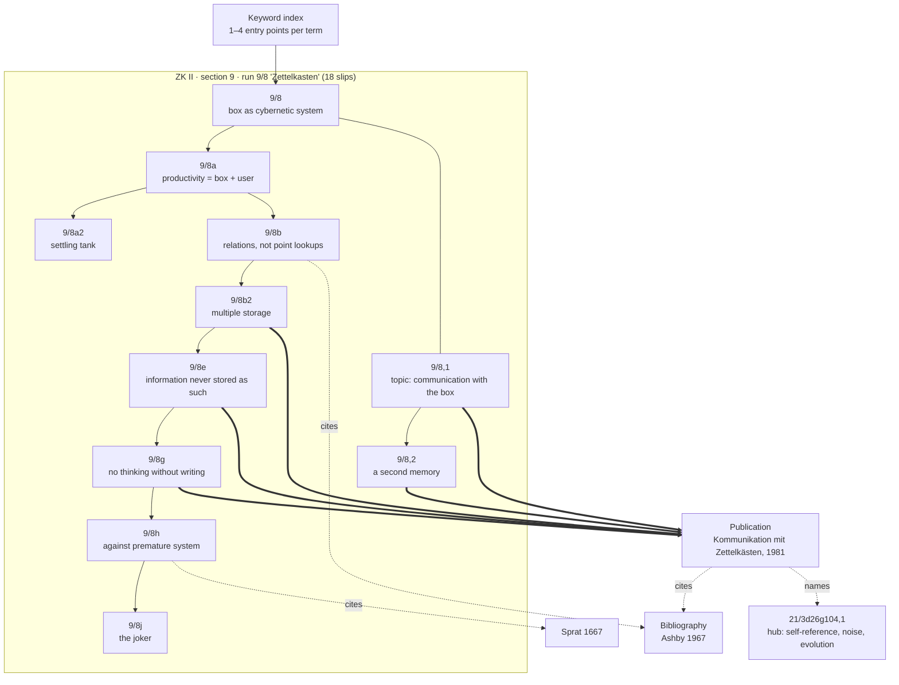

# Junior Partner: Niklas Luhmann's Slip-Box as a Working System

An illustrated essay for TDM 155AI, Making Stuff in the Age of AI — Week 5 exhibition on research, notebooks, workbooks, and preparation.

## Twenty-seven drawers, two collections

From the early 1950s to early 1997, the sociologist Niklas Luhmann wrote roughly 90,000 slips of paper. The Niklas Luhmann-Archiv at Bielefeld University, which is digitizing and transcribing them, counts 27 drawers of 2,500 to 3,500 slips each, divided into two separate collections (Archiv, "Auszüge"). Zettelkasten I (ZK I) — seven drawers, about 23,000 slips — comes from Luhmann's years as a legal clerk and civil servant in Lower Saxony, before he was an academic sociologist; the archive dates it to about 1952–1960, while Schmidt gives 1951–1962. Zettelkasten II (ZK II) — twenty drawers, about 67,000 slips — runs from the early 1960s to early 1997 and spans nearly his whole publishing career. The break may follow his 1960–61 year at Harvard with Talcott Parsons, though no document confirms it (Schmidt 2018, n. 6).

The material conditions matter. In a 1981 essay Luhmann specified wooden boxes with pull-out drawers and thin octavo paper rather than card stock, written on one side so a slip could be read without lifting it out (Luhmann 1981). ZK II often broke the one-side rule: into the 1970s he reused the blank backs of bibliographic slips for notes, and many backs carry material from a smaller collection he later dissolved (Archiv, "Der Zettelkasten"; Schmidt 2013/14). Thrift shaped the archive.

The collections are organized differently. ZK I has 108 numbered subject sections — state, equality, planning, power — plus a bibliography and an index. ZK II has only eleven top-level sections, from organization theory to "ad hoc notes" to advanced civilizations, which Schmidt reads as a residue of 1960s interests rather than a taxonomy (Schmidt 2018). ZK II also holds three bibliographic sections, a section of publication drafts, four successive keyword indexes, and a person index (Archiv, "Inhaltsübersicht").

## Addresses, not categories

The core decision is a fixed place rather than a fixed topic. Every slip receives a number that never changes (Luhmann 1981). ZK I separates section from position with a comma (17,2); ZK II uses a slash (21/3). A new slip goes wherever it connects: a side-thought on 1/1 becomes 1/1a, filed between 1/1 and 1/2; a branch off 1/1a becomes 1/1a1, and so on, alternating numbers and letters. Luhmann's illustration is 57/12, continued by 57/13 and branched at a particular word by 57/12a, the attachment point marked in red (Luhmann 1981): growth "inward." Numbers get long: Schmidt cites 21/3a1p5c4fB1a, which opens a ZK II subsection on confidentiality (Schmidt 2018).

Two consequences are easy to miss. The number records where a slip was put, not what it means — Schmidt warns that the alternation was applied inconsistently, so a number alone does not reveal how two slips relate (Schmidt 2018, n. 12). And because branches drift far from their origins, a topic's location says nothing about its importance. In Schmidt's phrase, "there is no top and no bottom."

## Links, hubs, and an index that refuses to be complete

Fixed addresses make references possible. Schmidt estimates about 20,000 written references in ZK I and 30,000 in ZK II, of three kinds: outline references (capital letters marking planned sub-sequences nearby); collective references (a slip listing up to 25 other locations, usually far away — a hub); and single references inside an argument, typically to a distant region (Schmidt 2018). References also solve what Luhmann called "multiple storage": file a note once and point to it from everywhere else it belongs (Luhmann 1981; ZK II 9/8b2).

Luhmann never made a table of contents — the archive's online overview is an editorial construction — so the keyword index was the main door. It is deliberately incomplete. ZK I's index has about 1,250 entries; ZK II's final version about 3,200, after Luhmann rebuilt it four times as it grew disordered. Under each keyword he usually listed one to four slip numbers: enough to land in the relevant web and follow references from there (Schmidt 2018). He justified this on a slip citing W. Ross Ashby's 1967 essay on the brain: memory works through relations among notes, not masses of point-by-point lookups (ZK II 9/8b).

Reading notes differ by period. ZK I's bibliography is a list of about 2,000 titles on roughly 160 slips. In ZK II Luhmann moved to one slip per title, and about a third of those slips carry a terse, keyword-style note on the source on the back — a record of reading beside, not inside, the argument (Schmidt 2013/14). Bibliographic slips also carry call numbers, copy reminders, and sometimes slip numbers pointing to the notes the reading fed — a second way in, since memory works partly by author (Archiv, "Der Zettelkasten"; Luhmann 1981). What he did not do was file excerpts. One slip says you read differently once you attend to what can become slips — "not: excerpts!" (ZK II 9/8d).

## A walk through 9/8

The system describes itself in a run of eighteen slips in ZK II section 9, the ad hoc section, where 9/1 is on student unrest, 9/7 on Heraclitus, and 9/8 is headed "Zettelkasten" (Archiv, "Inhaltsübersicht"). Nothing about its location announces importance.

Enter at **9/8**. Luhmann describes the box as a cybernetic system combining disorder and order, clustering and unforeseen combination realized at the moment of access; its precondition is giving up any fixed order. **9/8a** relocates the question: productivity belongs not to the box but to the relation between box and user. Its sub-branch **9/8a2** calls the box a *Klärgrube*, a settling tank, and advises against putting in only finished notes; deferring judgment is partly a matter of speed. **9/8b** carries the Ashby reference (1967, p. 103), linked in the online edition to its bibliography database; **9/8b2** names the consequence, "multiple storage"; **9/8d** turns to reading. **9/8e** makes the theoretical claim: information presupposes horizons of comparison that cannot be fixed in advance, so the box is productive because it exposes what was noted to what was not, producing information never stored as such. **9/8g** states the premise beneath everything — "Ohne zu schreiben kann man nicht denken" (without writing one cannot think), at least not in demanding contexts — and adds that thinking requires notching differences. **9/8h** cites Thomas Sprat's 1667 history of the Royal Society on refusing premature system. **9/8j** is a joke with teeth: somewhere is a slip that refutes all the others, but it changes its number whenever the drawer opens. A joker.

A comma-numbered run shares the address. **9/8,1** reads like a title proposal — "Kommunikation mit dem Zettelkasten" — asking how to find an adequate partner, a junior partner, now that staff are scarce and expensive. **9/8,2** adds that microprocessors are announced but not yet really available, and one's own memory needs relief; hence an attempt at a second memory. **9/8,3** imagines visitors who are shown everything, and nothing but that, and are disappointed accordingly. (The sources I consulted do not explain what the comma signals inside ZK II.)

The run is uneven: some slips are aphorisms; **9/8c** is only a prompt to think about interrupting interdependence. None is a polished paragraph, and outside reading is hinged to the argument rather than summarized.

## From slips to print

The archive suggests the 9/8 run arose largely in connection with Luhmann's essay "Kommunikation mit Zettelkästen: Ein Erfahrungsbericht," published in 1981 in a Festschrift for Elisabeth Noelle-Neumann (Archiv, "Der Zettelkasten"; Schmidt 2013/14). The correspondences are close. The essay presents itself as empirical research concerning "mich und einen anderen: meinen Zettelkasten" — the 9/8,1 topic carried out. Its first section restates 9/8g nearly verbatim, with *anschlußfähig* (connectable) where the slip speaks of selective access to memory. Its account of multiple storage matches 9/8b2; its claim that a query yields more than was stored matches 9/8e; its closing call for order plus disorder echoes 9/8; its memory footnote cites the Ashby essay of 9/8b; and it calls the box a "second memory," as 9/8,2 does.

Other slips — Sprat, the interdependence prompt, the joker, the disappointed visitors — stayed in the drawer, at least visibly. And the essay sends readers back in. A footnote on noise and self-organization reports that slip 21/3d26g104,1 lists references to self-reference, noise, morphogenesis and self-organization, system and environment, evolution, and difference — a hub, published by its address (Luhmann 1981, n. 5). It sits in the ZK II branch on self-reference, between subsections on closure and re-entry (Archiv, "Inhaltsübersicht").

The trace supports a modest claim. The box supplied the essay's conceptual moves and some of its phrasing; it did not supply the essay. Luhmann says so: theoretical publications do not come from copying out what is in the box, and the partnership pays off only at a high level of generalization, at the moment of evaluation (Luhmann 1981).

## How material gets in, and how a reader does

Drawing on a 1987 interview, Schmidt describes intake: by day Luhmann made rough notes while reading; in the evening he rewrote them as slips, asking how a book connected to slips already written (Schmidt 2018). Choosing a slip's place was part of writing it, usually with more than one acceptable answer — hence references to the alternatives, and later updates to older slips.

A reader enters through the index, a bibliographic slip, a hub, or an address printed in a publication, then follows written references and adjacent slips. The online edition adds what Luhmann never had: clickable references, three reading orders (physical sequence, numerical order, and editorially reconstructed strands), an index expanded with equivalent terms, and a bibliography database listing every slip that mentions a title (Archiv, "Tutorial"). It also plans to show which other slips cite each slip (Schmidt 2022, n. 43). Automatic backlinks, in other words, are an editorial addition.

How does a path produce a question? Luhmann's example: ask why museums stand empty while Monet or Picasso exhibitions are mobbed, and the box receives the question under an existing heading — a preference for what is temporally limited — not under "art" (Luhmann 1981). Surprise comes from the mismatch between the searcher's terms and the box's internal comparisons. Schmidt calls this the fabrication of serendipity and names its condition: without a specific question and limited time, one gets lost in the drawers.

## Friction, forgetting, maintenance

None of this was free. Luhmann wrote that the box needs years to reach critical mass; until then it returns only what you put in (Luhmann 1981). His 1968 lecture notes, "Technik des Zettelkastens," call finding the right level of abstraction a slow learning process (MS 2906). Upkeep consumed much of his time, and poorly linked regions became "black holes," some apparently untouched since written (Schmidt 2018). Luhmann expected this: some notes are never seen again while favoured clusters grow (Luhmann 1981). Errors stayed in; revisions arrived as new slips. The joker, 9/8j, is the system's own admission that it cannot see itself whole.

## What the advice literature keeps and invents

| Contemporary advice | What the evidence shows |
| --- | --- |
| Permanent IDs; insert new notes where they connect | Documented in both collections and the 1981 essay |
| Link to distant notes instead of duplicating | Documented: \~50,000 references; "multiple storage" |
| Sparse index of entry points | Documented: usually one to four numbers per keyword |
| Own words, not excerpts | Documented (9/8d; Schmidt 2018) |
| Separate source notes from idea notes | Partly: ZK II bibliographic slips with notes on the back; not uniform across periods |
| Fleeting / literature / permanent note types | Later systematization (Ahrens 2017) of practices only partly documented |
| Only polished, self-contained notes enter | Contradicted by 9/8a2 and prompt-slips like 9/8c |
| "Atomic" one-idea notes (e.g. Matuschak) | Later gloss: many slips are short, but Luhmann describes continuous texts spread across slips |
| Backlinks | Luhmann advised writing back-references by hand; automatic backlinks belong to software and the edition |
| Tag everything | Not his practice; the index was intentionally incomplete |
| The box writes the books | Unsupported; Luhmann explicitly denies it |

Ahrens (2017), the main popularizer, describes two boxes, bibliographic and main. The archive's two collections are chronological, each with its own bibliography: the system was restarted, not designed once.

## A box for the rehearsal room

Luhmann's box served one author, in text, over a lifetime, for a theory demanding conceptual consistency; he chose an open collection over a thematic one deliberately (Luhmann 1981). The choreographer Twyla Tharp describes the opposite: "I start every dance with a box" — one per project, filled with notebooks, clippings, music, and rehearsal video, then shelved when the piece is done (Tharp 2003). Theatre-makers live between the two: a production closes; a practice does not.

Some features translate: theatre already knows fixed addresses with insertion — point cue 12.5 slides between 12 and 13 without renumbering the show. Others strain. A rehearsal box holds gesture, image, sound, blocking, and things other people said in a room, much of which resists a slip. Luhmann's surprises came from his past self; a company's box might surprise through someone else's entry, raising questions he never faced about authorship and whose index governs. And the question-with-a-deadline that keeps one from getting lost is built in: opening night.

## Experiment: the two-week box

Run this before the exhibition, on A6 slips or as a folder of Markdown files.

1. **Address.** Give each slip a permanent ID (1, 1a, 1a1, 2). In Markdown the ID is the filename; links are `[[1a]]`. Never renumber.
2. **Intake.** Write at least three slips a day from reading, rehearsal, or making. Before filing, write one sentence on why it sits behind its parent.
3. **Reach.** Every new slip names at least one non-adjacent slip, with a phrase saying how they relate.
4. **Index.** One index slip; at most three IDs per keyword.
5. **Sources.** One slip per source, your note on the back. No excerpt longer than a line.
6. **Friction log.** Record minutes spent filing and maintaining. In Markdown, turn off the backlinks pane for week one.
7. **Query.** In week two, put a project question to the box. Enter through the index, record your path as a list of IDs, and write one slip you did not expect to write.

Then ask a model to propose five links per slip; mark each `~` and keep it only if you can say why it holds. Count how many you kept, and whether any lay on your query path.

AI links add speed, recall across a box too large to remember, and bridges across vocabulary you no longer share with your past self. They obscure provenance — who linked, and why — and skip the placement decision Luhmann treated as the moment of thinking. Similarity pulls toward the alike; his best references jumped to distant regions for reasons he could state. Keep the reason, and the box stays a junior partner rather than a ghostwriter.

---

## Wall label (150 words)

**Niklas Luhmann's slip-box, 1951–1997**

Over four decades the sociologist Niklas Luhmann wrote about 90,000 slips of paper and filed them in wooden drawers. He gave each slip a permanent number rather than a subject, so a new thought could be inserted wherever it connected: 21/3, then 21/3a, then 21/3a1. Handwritten references sent him from one region of the box to distant others, and a deliberately sparse index offered only a few ways in. He called the result a second memory and, half-joking, a junior partner that could surprise him. It did not write his books. It took years to become useful, demanded constant upkeep, and let some notes vanish for good. On one slip, Luhmann imagined visitors who are shown everything in the box and are disappointed. The notebooks in this room ask something else of you: not to see everything, but to watch preparation turn into a question.

---

## Diagram: the 9/8 run and its connections

**Legend.** Solid arrows: filing sequence, simplified (intermediate slips such as 9/8a1, 9/8b1, 9/8c, 9/8d, 9/8f, 9/8i omitted). Plain line: the comma run shares the 9/8 address; its physical position is not established here. Dashed arrows: references written on the slip or printed in the essay. Thick arrows: correspondences between slip and essay identified by comparing texts — consistent with the archive's view that the run was written in connection with the essay, but not links Luhmann wrote. The index-to-9/8 arrow is illustrative; I have not verified which keyword points there.

---

## Visual candidates

Confirm reproduction permissions with the Niklas Luhmann-Archiv before printing. Slips are catalogued by the archive as undated within the span of their collection.

1. **ZK II Zettel 9/8 (front).** ID `ZK_2_NB_9-8_V`. [https://niklas-luhmann-archiv.de/bestand/zettelkasten/zettel/ZK_2_NB_9-8_V](https://niklas-luhmann-archiv.de/bestand/zettelkasten/zettel/ZK_2_NB_9-8_V). Undated; ZK II spans the early 1960s–1997, and the archive associates this run with the 1981 essay. *Caption:* The first slip of Luhmann's eighteen-slip run on the slip-box itself, filed in an "ad hoc" section beside notes on student unrest and Heraclitus. It calls the box a cybernetic system that combines order and disorder.
2. **ZK II Zettel 9/8g (front).** ID `ZK_2_NB_9-8g_V`. [https://niklas-luhmann-archiv.de/bestand/zettelkasten/zettel/ZK_2_NB_9-8g_V](https://niklas-luhmann-archiv.de/bestand/zettelkasten/zettel/ZK_2_NB_9-8g_V). Undated. *Caption:* "Without writing one cannot think." This slip's sentence reappears, slightly revised, on the first page of Luhmann's 1981 essay about communicating with his box.
3. **ZK I keyword index, first slip.** ID `ZK_2_SW1_001_V`. [https://niklas-luhmann-archiv.de/bestand/zettelkasten/zettel/ZK_2_SW1_001_V](https://niklas-luhmann-archiv.de/bestand/zettelkasten/zettel/ZK_2_SW1_001_V). Undated; ZK I period (c. 1951–1962). Physically kept in ZK II drawer 17, hence the ZK_2 prefix. *Caption:* Luhmann's index never tried to be complete. Each keyword points to a handful of slips — a few doors into a web of references rather than a list of every mention.
4. **"Technik des Zettelkastens," typescript lecture notes.** Manuscript MS 2906, 1968. [https://niklas-luhmann-archiv.de/bestand/manuskripte/manuskript/MS_2906_0001](https://niklas-luhmann-archiv.de/bestand/manuskripte/manuskript/MS_2906_0001). *Caption:* A one-page set of 1968 lecture notes in which Luhmann explains his technique to others — starting with a cardboard box, moving to wooden drawers, and warning that learning the right level of abstraction is slow.

*Alternates:* ZK I bibliography list, `ZK_2_BG1a_001_V` ([https://niklas-luhmann-archiv.de/bestand/zettelkasten/zettel/ZK_2_BG1a_001_V);](https://niklas-luhmann-archiv.de/bestand/zettelkasten/zettel/ZK_2_BG1a_001_V%29;) ZK I note 17,2, showing comma numbering, `ZK_1_NB_17_2_V` ([https://niklas-luhmann-archiv.de/bestand/zettelkasten/zettel/ZK_1_NB_17_2_V)](https://niklas-luhmann-archiv.de/bestand/zettelkasten/zettel/ZK_1_NB_17_2_V%29).

---

## Sources

**Primary**

- Luhmann, Niklas. ZK II Zettel 9/8 through 9/8,3 (undated). Niklas Luhmann-Archiv, Universität Bielefeld. [https://niklas-luhmann-archiv.de/bestand/zettelkasten/zettel/ZK_2_NB_9-8_V](https://niklas-luhmann-archiv.de/bestand/zettelkasten/zettel/ZK_2_NB_9-8_V) and adjacent IDs (e.g. ZK_2_NB_9-8b2_V, ZK_2_NB_9-8g_V, ZK_2_NB_9-8-2_V).
- Luhmann, Niklas (1981). "Kommunikation mit Zettelkästen. Ein Erfahrungsbericht." In H. Baier, H. M. Kepplinger, K. Reumann (eds.), *Öffentliche Meinung und sozialer Wandel. Für Elisabeth Noelle-Neumann*, 222–228. Opladen: Westdeutscher Verlag. [https://doi.org/10.1007/978-3-322-87749-9_19](https://doi.org/10.1007/978-3-322-87749-9_19). English translation by Manfred Kuehn, "Communicating with Slip Boxes."
- Luhmann, Niklas (1968). "Technik des Zettelkastens." MS 2906. Niklas Luhmann-Archiv. [https://niklas-luhmann-archiv.de/bestand/manuskripte/manuskript/MS_2906_0001](https://niklas-luhmann-archiv.de/bestand/manuskripte/manuskript/MS_2906_0001). English translation: Chris Aldrich, boffosocko.com.
- Luhmann, Niklas (1987). "Biographie, Attitüden, Zettelkasten." In *Archimedes und wir*, ed. D. Baecker and G. Stanitzek, 125–155. Berlin: Merve. (Cited via Schmidt 2018.)

**Archive and edition**

- Niklas Luhmann-Archiv. "Der Zettelkasten Niklas Luhmanns." [https://niklas-luhmann-archiv.de/nachlass/zettelkasten](https://niklas-luhmann-archiv.de/nachlass/zettelkasten)
- Niklas Luhmann-Archiv. "Tutorial zum digitalen Zettelkasten." [https://niklas-luhmann-archiv.de/bestand/zettelkasten/tutorial](https://niklas-luhmann-archiv.de/bestand/zettelkasten/tutorial)
- Niklas Luhmann-Archiv. "Übersicht über die Auszüge." [https://niklas-luhmann-archiv.de/bestand/zettelkasten/auszuege](https://niklas-luhmann-archiv.de/bestand/zettelkasten/auszuege)
- Niklas Luhmann-Archiv. "Inhaltsübersicht." [https://niklas-luhmann-archiv.de/bestand/zettelkasten/inhaltsuebersicht](https://niklas-luhmann-archiv.de/bestand/zettelkasten/inhaltsuebersicht)

**Scholarship**

- Schmidt, Johannes F. K. (2013/14). "Der Nachlass Niklas Luhmanns – eine erste Sichtung: Zettelkasten und Manuskripte." *Soziale Systeme* 19(1). [https://doi.org/10.1515/sosys-2014-0111](https://doi.org/10.1515/sosys-2014-0111)
- Schmidt, Johannes F. K. (2016). "Niklas Luhmann's Card Index: Thinking Tool, Communication Partner, Publication Machine." In A. Cevolini (ed.), *Forgetting Machines: Knowledge Management Evolution in Early Modern Europe*, 289–311. Leiden: Brill.
- Schmidt, Johannes F. K. (2018). "Niklas Luhmann's Card Index: The Fabrication of Serendipity." *Sociologica* 12(1). [https://doi.org/10.6092/issn.1971-8853/8350](https://doi.org/10.6092/issn.1971-8853/8350)
- Schmidt, Johannes F. K. (c. 2022). "Niklas Luhmanns Zettelkasten: Herausforderungen einer Digitalen Edition." Springer VS. [https://doi.org/10.1007/978-3-658-34744-4_12](https://doi.org/10.1007/978-3-658-34744-4_12)

**Contemporary advice and comparison**

- Ahrens, Sönke (2017). *How to Take Smart Notes.*
- Fast, Sascha (2022). "English Translation of All Notes on Zettelkasten by Luhmann." [https://zettelkasten.de/posts/luhmanns-zettel-translated/](https://zettelkasten.de/posts/luhmanns-zettel-translated/)
- Matuschak, Andy. "Zettelkasten." [https://notes.andymatuschak.org/Zettelkasten](https://notes.andymatuschak.org/Zettelkasten)
- Tharp, Twyla (2003). *The Creative Habit: Learn It and Use It for Life.* New York: Simon & Schuster.