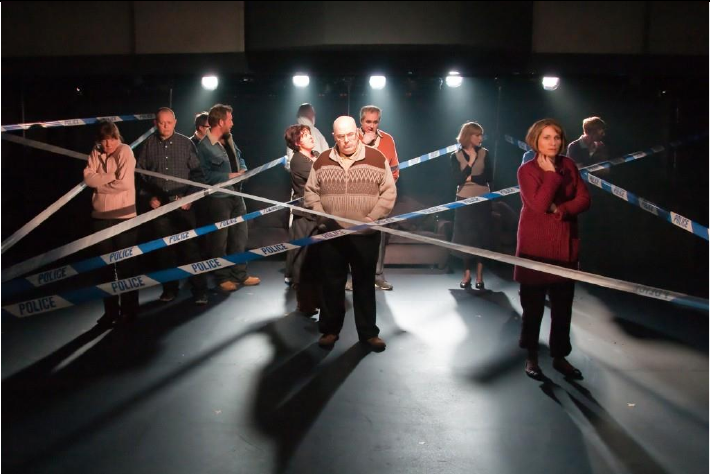
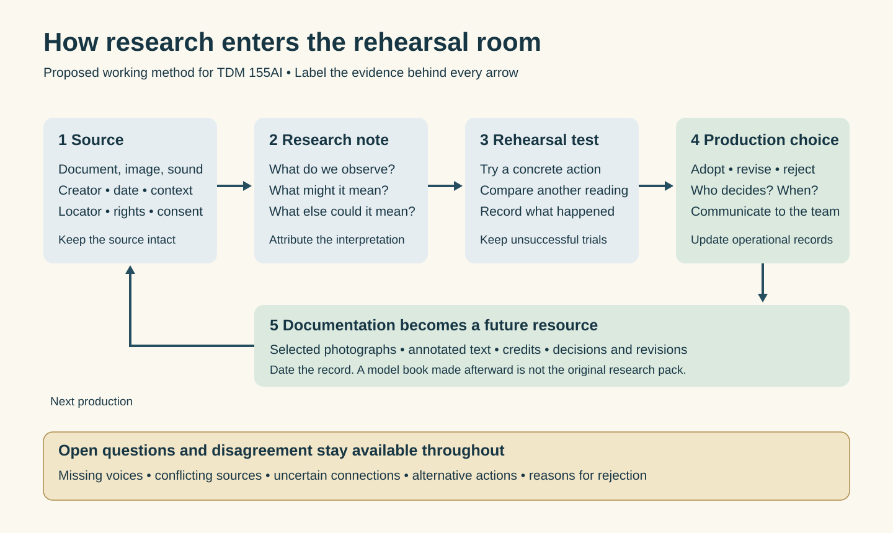

# How theatrical research becomes a shared working resource

A rehearsal room gives research a demanding test: can something collected elsewhere change what happens here? A photograph might alter the way an actor holds her head. An interview might determine a song’s rhythm. A note might become a request to a costume department. The decisive movement is from information someone possesses to material other people can act upon. For TDM 155AI’s week on research and preparation, theatre offers a model of a workbook whose pages must eventually become actions.

Dramaturgical research investigates the world, language, structure, and competing possibilities of a performance. It can involve historical scholarship, close reading, interviewing, collecting images, and observing everyday behavior. Its theatrical value is not measured simply by the number of references gathered. A useful research note connects a source to a question: What does this evidence let us try? What would change if we interpreted it differently? Who has been left outside the frame?

Two productions make these questions concrete: Brecht and Erich Engel’s Berlin *Mother Courage and Her Children*, which opened on 11 January 1949, and Rufus Norris’s *London Road*, first performed at the National Theatre’s Cottesloe in April 2011. Their surviving records show different relationships between preparation and documentation. They also warn us that a persuasive archive can make a particular interpretation seem inevitable. [Brecht edition](https://www.bloomsbury.com/au/brecht-on-performance-9781350077065/); [National Theatre production record](https://catalogue.nationaltheatre.org.uk/CalmView/Record.aspx?id=PERF7724&src=CalmView.Performance).

## Five objects with different jobs

These are practical distinctions, not universal filing rules. The table describes customary functions; it does not claim that five separately titled objects survive for either production.

| Object | When and by whom | Readers and revision | What it does |
| --- | --- | --- | --- |
| Dramaturgical dossier | Usually begun before rehearsals by a dramaturg, researcher, or several collaborators | Selected for actors, director, designers, and production staff; expanded or corrected as questions arise | Connects sources, contexts, textual problems, and open questions. It should distinguish evidence from interpretation. |
| Director’s notebook | Begun in preparation and continued by the director, sometimes with assistants | Often private or selectively shared; accumulates changing intentions, blocking experiments, and reflections | Records the director’s developing approach. Its exploratory instructions are not automatically company decisions. |
| Designer’s reference collection | Gathered before and during design by designers and assistants | Shared with collaborators, workshops, and makers; revised as materials, budgets, and staging develop | Connects images, textures, objects, spatial research, and technical possibilities to proposed designs. A mood board is only one possible form. |
| Stage manager’s prompt book | Developed through rehearsals and technical rehearsals by stage management | Used to coordinate and run the production, including handover to replacements; updated for accepted changes | Anchors cues, movements, and operational information to a script or score. Related rehearsal reports communicate work to departments. |
| Model book | Assembled from rehearsal and production records by a documenting team; sometimes circulated before formal publication | Made for later practitioners and study; may incorporate subsequent productions and revisions | Selects images and commentary to transmit an achieved staging and its reasoning. It can become another production’s starting resource. |

Their overlap matters. A timeline can accompany a prompt script; a designer’s image can enter a director’s notebook; a rehearsal photograph can become part of a model. Identify an object by its date, maker, audience, and use. A folder marked “research” may contain publicity created years later. Keep the original record and later interpretation distinguishable.

## Mother Courage and the production that became a model

Gideon Lester’s 2001 A.R.T. essay provides the starting question: how should later artists work with Weigel’s influential performance? He describes a telling piece of business. Paying for Kattrin’s burial, Courage counts money and withdraws one coin. The published stage directions alone do not supply this detail. The model transmits an acting choice that makes her commercial habits visible even in bereavement. [Lester, “A Model of Courage”](https://americanrepertorytheater.org/media/a-model-of-courage/).

That action does interpretive work. A later actor can test the pause, the hand, the purse, and the amount of attention given to the money. Does the gesture suggest calculation, deprivation, habit, or several things together? The model offers something more usable than an abstract instruction to “show capitalism.” But we cannot infer that a particular historical document originally generated the coin gesture. Here the defensible connection runs from recorded staging into a resource for subsequent practice.

The title *Couragemodell 1949* can mislead. Its date identifies the foundational production, not publication. Compilation followed the opening in spring 1949; versions developed through Munich in 1950 and Berlin in 1951. Early notes involved assistant Heinz Kuckhahn and Brecht’s corrections; Ruth Berlau and Hainer Hill supplied photographs. Berlau and Peter Palitzsch helped prepare the publication, which appeared posthumously in 1958. This is accumulated production knowledge, not a packet issued before the original rehearsals. [Chronology and editorial history, scholarly dissertation, note 13](https://www.collectionscanada.gc.ca/obj/s4/f2/dsk2/ftp02/NQ44651.pdf); [1958 edition record](https://openlibrary.org/books/OL2824306M/Couragemodell_1949).

David Richard Jones describes the published object as three volumes: the play, production photographs, and notes. Their separation is instructive. The play is not a complete specification of everything people did; images and commentary supplement it. A production produces knowledge that a literary text cannot contain alone. [Jones, *Great Directors at Work*, chapter 6](https://www.jstor.org/stable/10.1525/j.ctt7zw3wm).

**Visual pairing:** exhibit the model’s three-part structure beside its scene-three photographic sequence. The first shows how knowledge was organized; the second shows what that organization could transmit. See candidates 1 and 2 in the [visual brief](visual-candidates.md).

The famous silent scream presents a more difficult source trail. Brecht’s commentary cautiously attributes Weigel’s posture to a press photograph of a bereaved Indian woman during Singapore’s bombardment; it says Weigel did not recall the image when asked, and that the gesture entered later performances. That qualification prevents us from assigning it automatically to opening night. [*Brecht on Performance*, “Observation,” 2018 edition, p. 228](https://www.bloomsbury.com/au/brecht-on-performance-9781350077065/).

A different retrospective account appears in Martina Kolb’s study. Quoting Weigel through a published archival exhibition volume, Kolb reports her recollection of a woman at a mass grave in Brecht’s clipping collection. Weigel connected the posture with her own observations of bodily pain. These accounts support a relationship between collected imagery and acting, but do not establish one securely identified original photograph. We should preserve their disagreement rather than fuse them into a smooth origin story. [Kolb, “The Mask as Interface,” *Communications* 34, June 2005, pp. 82–83 and notes 13–15, pp. 90–91](https://asset.library.wisc.edu/1711.dl/B47LC3AJDTMVG8H/E/file-3c1ab.pdf).

The consequential transformation is nevertheless intelligible: an observed expression becomes an actor’s bodily experiment, then a photographed performance, then an example for other actors. The photograph of Weigel demonstrates the resulting posture; it cannot independently prove the source or reconstruct the experiment. Nor does its stillness establish the duration of the gesture. A source trail needs testimony and dated records as well as visual resemblance.

Revision remained possible. The model records an added final-scene line about returning to business, first used in Munich and then Berlin. Its account of Brecht’s Munich rehearsals describes photographs informing spacing while alternative solutions remained available. These are evidence of change within the model’s history. [*Brecht on Performance*, “A change in the text,” p. 234, and “How the Director Brecht Uses His Own Model,” p. 259](https://www.bloomsbury.com/au/brecht-on-performance-9781350077065/).

An apparatus for sharing discoveries also concentrated authority. The Akademie der Künste describes the Courage model as a binding pattern for subsequent stagings. Lester, however, emphasizes its intended capacity to stimulate artistic thought. Those functions can coexist uneasily. Learning from a predecessor is valuable; accepting that predecessor’s interpretation as the test of every new experiment is a stronger demand. [Akademie account of the production and model](https://frontend.adk.de/news/2020/05-11/die-couragefigur-hellis-jetzt-herrlich-von-grosser-kuhnheit); [A.R.T. discussion](https://americanrepertorytheater.org/media/a-model-of-courage/).

Calling all this “Brecht’s book” obscures essential labor. Weigel made choices with her body; Engel co-directed; Kuckhahn recorded; photographers framed what could be remembered; Berlau and Palitzsch helped organize and edit what could be passed on. Those contributions are constitutive of the resource. For students, attribution should follow the actual work: collecting, observing, performing, recording, selecting, and maintaining.

## London Road and research that became performance material

*London Road*, with book and lyrics by Alecky Blythe and music and lyrics by Adam Cork, concerns a community affected by the murders of five women in Ipswich in 2006. Blythe recalls collecting interviews before Steve Wright’s arrest, shelving the recordings, then bringing them to a National Theatre Studio workshop. Songs emerged through experiment; further events prompted further interviewing. The collection’s eventual purpose was discovered through making. [Blythe’s 2012 interview](https://www.whatsonstage.com/news/brief-encounter-with-london-roads-alecky-blythe_3237/).

This production is particularly useful because its identifiable company archive links several kinds of record: prompt scripts, costume files, production photographs, show reports, and a contemporary makers’ discussion. A prompt-book box also contains a research timeline. Its compiler and insertion date are not established by the public description; proximity to operational paperwork does not prove when a research sheet was first circulated. [Production catalogue](https://catalogue.nationaltheatre.org.uk/CalmView/Record.aspx?id=PERF7724&src=CalmView.Performance); [National Theatre finding aid, p. 10](https://images.nationaltheatre.org.uk/uploads/2025/02/Teaching-Practitioners-Using-the-Archive_2025.pdf).

*Research preview: London Road, 2011, photograph by Helen Warner, reproduced in the National Theatre finding aid, p. 7. This image documents staging; it does not establish which source prompted the police-tape arrangement. No exhibition reproduction license has been established. See visual candidate 4.*

One unusually explicit trail concerns “The Verdict.” Cork recalls a recording of two reporters receiving and speaking news simultaneously. He expanded their overlap into a quartet and added a chorus conveying numbers. His account explains how the musical texture grows crowded and finally joins in unison. A gathered sound reference thus affected the organization of performing voices. This is a retrospective maker’s explanation, not an inspected workshop manuscript. [Cork interviewed by Michael Friedman, The Civilians, 2016](https://extendedplay.thecivilians.org/composers-michael-friedman-and-adam-cork-discuss-the-verbatim-film-musical-london-road-91516/).

The change is larger than illustration. An interview recording initially makes a claim on attention: listen to what these particular people said. The composition asks performers to enact competing streams of information together. The research becomes a constraint and a material to transform. A transcript retaining the words while removing timing would leave out something essential to this decision.

Cork also describes composing phrase by phrase, preserving speech’s contours while allowing musical adjustments. Exactness therefore has several meanings: verbal fidelity, relative rhythm, melodic shape, or absolute pitch. A shared dossier should specify which fidelity matters in a given experiment. It should not use “authentic” as a substitute for explaining the transformation. [Cork’s account of composition, Oxford Culture Review, 2017](https://theoxfordculturereview.com/2017/01/29/the-magic-wand-of-artistic-transformation-adam-cork-on-london-road/).

The National Theatre’s finding aid reports that actors learned primarily from audio, received photographs with limited additional background, and performed without the earpieces customary in Blythe’s other work. It also reproduces a 4 March 2011 note recording Blythe’s information that the radio personnel wore Town 102 jackets. This establishes a researched detail entering departmental communication, not proof of the final costume. On 9–10 March, notes request Bailey’s bark and correct the dog’s identification after further investigation. These dated amendments show research continuing during rehearsal. [Finding aid, pp. 9–10](https://images.nationaltheatre.org.uk/uploads/2025/02/Teaching-Practitioners-Using-the-Archive_2025.pdf).

The jackets and bark reveal a less celebrated interface: the rehearsal report. A researcher’s correction must reach someone able to act on it. Recording the date and amendment makes organizational labor visible and prevents yesterday’s assumption from silently becoming tomorrow’s fact. The value is not that every detail must survive unchanged; it is that a team can see which detail it is choosing to preserve or alter.

Rich evidence does not mean unrestricted access. This essay consulted catalogue descriptions, publicly reproduced report extracts, and published interviews; it did not inspect the complete prompt books or original interview tapes. The archive offers booked research visits, while complete recordings and documents are not simply downloadable from their catalogue entries. The 2015 feature film is an adaptation, not a substitute record of the 2011 performance. [Archive access](https://catalogue.nationaltheatre.org.uk/CalmView/ContactUs.aspx); [Norris on adapting the production, BFI](https://www.bfi.org.uk/interviews/rufus-norris-there-no-blueprint-london-road).

## Sharing evidence without closing interpretation

The interviewees also contributed material and time. Preserving their words does not remove the makers’ power to choose whose voices dominate. Evi Stamatiou argues that the stage work privileges residents’ recovery while giving less space to sex workers’ perspectives. This is a scholarly interpretation to debate, not an archival finding that settles the production’s meaning. [Stamatiou, “A Brechtian Perspective on London Road,” repository manuscript, especially pp. 8–9](https://eprints.chi.ac.uk/4579/1/A%20Brechtian%20perspective%20on%20London%20Road.pdf).

A dossier opens possibilities when people can inspect sources, propose incompatible readings, and run different experiments. It hardens when the selection becomes invisible and the interpretation acquires the status of fact. The risk is especially acute when a polished collection bears an institution’s or famous director’s name. Ask who can add a question, challenge a caption, or record that an experiment failed. A resource becomes shared through those permissions as well as through access to its pages.

For this exhibition, put the source, research note, and production choice alongside one another. Label the connecting arrow too: contemporaneous report, retrospective testimony, or proposed experiment. A viewer should be able to distinguish an observed result from an attractive hypothesis. That makes the wall a place to examine preparation rather than admire its apparent completeness.

*Original diagram for TDM 155AI. Documentation returns to future preparation; disagreement remains available throughout. [Diagram and evidence key](diagram.md).*

## A starter dossier and three AI research tasks

For a student scene about a disputed campus space, begin with a small, inspectable dossier: a dated project question; two contrasting accounts; one historical document; one spatial or visual reference; and one consented sound or interview excerpt. Give every item its creator, date, location, rights or consent status, exact locator, and reason for inclusion. Separate the source from the student’s annotation. Include a missing-voices page and a page of questions that nobody has resolved.

Add a rehearsal ledger with columns for source, proposed action, person proposing it, date tried, observation, and decision. Try the same scene using two readings of one item. Retain both results, including rejected choices. Keep an operational cue sheet separate; after the showing, assemble a modest model book clearly dated as documentation. Credit researchers, interviewees, performers, organizers, and editors individually.

Three AI tasks can support this work:

1. **Find candidate sources.** Ask AI to suggest archive collections, search terms, and contrasting accounts. Students must open each source, verify the item and locator, and replace invented or inaccessible citations with an explicit gap. Preserve conflicting searches and missing perspectives.
2. **Prepare provisional transcription or description.** Ask AI to transcribe a permitted excerpt or describe an image. Students compare it directly with the recording or image, correct names and timing, and retain uncertainties. Preserve pauses, overlapping speech, and alternative readings rather than accepting a cleaned transcript as the source.
3. **Compare evidence with the decision ledger.** Ask AI to identify unsupported connections and generate two rehearsal experiments from competing interpretations. Students verify each proposed connection against a dated note or attributed testimony, then judge experiments through rehearsal. Keep the rejected interpretation and its reasons beside the accepted choice.

The students remain responsible for deciding what the evidence can support. Their dossier should make it easy for another person to retrace that decision, disagree with it, and try something else.
